<p align="center">
  
</p>

<h1 align="center">Pimento</h1>

<p align="center">
  <strong>Bulk-activate your Azure PIM roles from a native Mac app.</strong><br>
  Every eligible role on one screen. Pick the ones you need, give one justification, activate them in parallel.
</p>

<p align="center">
  <a href="https://github.com/melvin2306/pimento/actions/workflows/ci.yml"></a>
  
  
  
  <a href="LICENSE"></a>
</p>

<p align="center">
  <a href="#download"><strong>Download for Mac</strong></a> ·
  <a href="#install-the-command-line-tool"><strong>Install the CLI</strong></a> ·
  <a href="#screenshots">Screenshots</a> ·
  <a href="#demo-mode">Demo mode</a>
</p>

---

If you work with [Privileged Identity Management](https://learn.microsoft.com/entra/id-governance/privileged-identity-management/pim-configure)
for **Azure resources**, you know the routine: open the portal, find each subscription or
resource group, click *Activate*, type the same justification again, wait, repeat. Pimento
does the whole list in one go, as you, using the Azure CLI session you already have, or
[its own sign-in](#pimento-sign-in-without-the-azure-cli) when there is no Azure CLI.

<p align="center">
  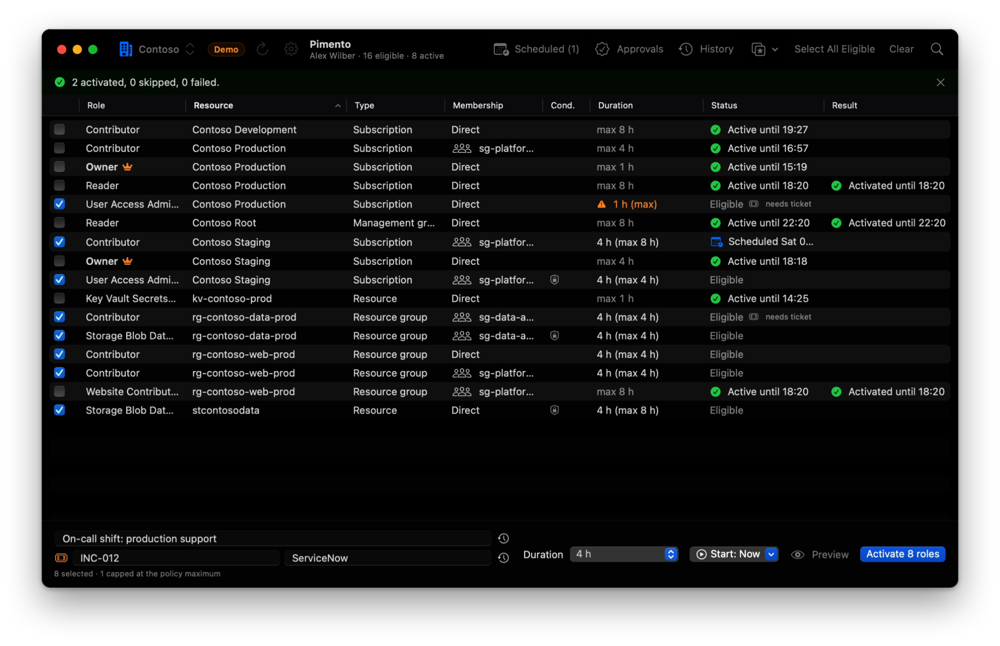
  <br><sub>Demo mode, synthetic data. More in <a href="#screenshots">Screenshots</a>.</sub>
</p>

## Download

<p align="center">
  <a href="https://github.com/Melvin2306/pimento/releases/latest/download/Pimento.dmg"></a>
  <br>
  <sub><a href="https://github.com/Melvin2306/pimento/releases/latest/download/Pimento.dmg">Pimento.dmg</a> · macOS 14 Sonoma or later · Apple silicon and Intel · free and open source (MIT)</sub>
</p>

1. **Open `Pimento.dmg`** and drag **Pimento** onto **Applications**.
2. **Open Pimento** from Applications. The first time, macOS blocks it: Pimento is a free
   open-source app that is not notarized by Apple (notarization needs a paid Apple developer
   account), so macOS cannot check it for you. You can check the download yourself
   ([Verify](#verify-a-download)). To allow it once:
   - **macOS 15 Sequoia and later**: click **Done**, open **System Settings › Privacy & Security**,
     scroll down to *"Pimento" was blocked…*, click **Open Anyway** and confirm.
   - **macOS 14 Sonoma**: right-click (or Control-click) Pimento, choose **Open**, then **Open**.
3. **Sign in.** Pimento uses your Azure CLI session: install the
   [Azure CLI](https://learn.microsoft.com/cli/azure/install-azure-cli-macos) and run `az login`
   in Terminal. No Azure CLI? Use [Pimento sign-in](#pimento-sign-in-without-the-azure-cli) instead.

**Try it without Azure:** choose **Pimento › Demo Mode**. Every feature works against a simulated
Azure with synthetic data, offline, without touching your own settings ([Demo mode](#demo-mode)).

The app has the `pimento` command-line tool inside: **Pimento › Install Command Line Tool…** puts
it on your PATH ([details](#the-cli-from-the-app)).

## Install the command-line tool

`pimento` runs on macOS, Linux and Windows. One command installs it for your user (no `sudo`, no
administrator rights):

```sh
# macOS and Linux: installs to ~/.local/bin, plus completions for your shell
curl -fsSL https://raw.githubusercontent.com/Melvin2306/pimento/main/scripts/install.sh | sh
```

```powershell
# Windows (PowerShell): installs to %LOCALAPPDATA%\Programs\Pimento, adds it to your user PATH,
# and sets up tab completion in your PowerShell profile
irm https://raw.githubusercontent.com/Melvin2306/pimento/main/scripts/install.ps1 | iex
```

Then:

```sh
pimento --demo list      # try it with synthetic data, no Azure needed
az login                 # or: pimento login (Pimento sign-in)
pimento list             # your eligible PIM roles
```

The installers download the archive for your system from the latest release, check its SHA-256
against the release's `SHA256SUMS.txt` (and its build attestation, when the
[GitHub CLI](https://cli.github.com/) is installed and signed in), and stop without installing
anything if a check fails. `install.sh` changes no shell startup file: when the folder is not on
your PATH, it prints the line to add. `install.ps1` adds one marked block to your PowerShell profile
(`$PROFILE.CurrentUserAllHosts` of the PowerShell you run it in) that loads the completions: it
replaces that block on every install, keeps the rest of the profile as it was, and `-Uninstall`
removes it again (`$env:PIMENTO_NO_COMPLETIONS = "1"` skips it). You can read them first:
[`install.sh`](scripts/install.sh), [`install.ps1`](scripts/install.ps1).

- **A specific version:**
  `curl -fsSL https://raw.githubusercontent.com/Melvin2306/pimento/main/scripts/install.sh | PIMENTO_VERSION=0.1.0 sh`
  (on Windows, `$env:PIMENTO_VERSION = "0.1.0"` before `irm … | iex`).
- **Another folder:**
  `curl -fsSL https://raw.githubusercontent.com/Melvin2306/pimento/main/scripts/install.sh | sh -s -- --dir ~/bin`
  (on Windows, `$env:PIMENTO_INSTALL_DIR`). `sh -s -- --help` lists all options.
- **Linux** needs glibc 2.35 or later (Ubuntu 22.04, Debian 12, RHEL 9) and libcurl; **Windows**
  10/11 (x86_64) needs the Microsoft Visual C++ Redistributable, which most systems have.
- **Update:** run the same command again; it replaces the installed version with the latest
  release. `pimento version --check` tells you whether there is a newer one ([Updates](#updates)).

**Uninstall:**

```sh
curl -fsSL https://raw.githubusercontent.com/Melvin2306/pimento/main/scripts/install.sh | sh -s -- --uninstall
```

```powershell
$env:PIMENTO_UNINSTALL = "1"; irm https://raw.githubusercontent.com/Melvin2306/pimento/main/scripts/install.ps1 | iex; $env:PIMENTO_UNINSTALL = $null
```

Both leave Pimento's own files (presets, history, sign-in settings) in place; run
`pimento logout --all` first to remove a Pimento sign-in. On Windows, uninstalling also removes the
completion block from your PowerShell profiles.

### Manual download

Every release has these files under stable names, so the links always point to the latest version
(and the same files with the version in their name, e.g. `Pimento-0.1.0.dmg`):

| Download | Contains |
| --- | --- |
| [`Pimento.dmg`](https://github.com/Melvin2306/pimento/releases/latest/download/Pimento.dmg) | Pimento.app (universal) with the `pimento` CLI inside |
| [`Pimento.zip`](https://github.com/Melvin2306/pimento/releases/latest/download/Pimento.zip) | the same app as a zip |
| [`pimento-cli-macos.tar.gz`](https://github.com/Melvin2306/pimento/releases/latest/download/pimento-cli-macos.tar.gz) | the CLI for macOS (universal), shell completions, LICENSE, README |
| [`pimento-cli-linux-x86_64.tar.gz`](https://github.com/Melvin2306/pimento/releases/latest/download/pimento-cli-linux-x86_64.tar.gz) | the CLI for Linux x86_64 (Swift runtime linked in), shell completions |
| [`pimento-cli-linux-aarch64.tar.gz`](https://github.com/Melvin2306/pimento/releases/latest/download/pimento-cli-linux-aarch64.tar.gz) | the same for Linux arm64 (aarch64) |
| [`pimento-cli-windows-x86_64.zip`](https://github.com/Melvin2306/pimento/releases/latest/download/pimento-cli-windows-x86_64.zip) | `pimento.exe` with the Swift runtime DLLs, PowerShell completions |
| [`SHA256SUMS.txt`](https://github.com/Melvin2306/pimento/releases/latest/download/SHA256SUMS.txt) | SHA-256 of every file |

By hand, for example on macOS (on Linux, use the Linux archive and skip `xattr`):

```sh
tar -xzf pimento-cli-macos.tar.gz
cd pimento-cli-*-macos
xattr -d com.apple.quarantine pimento 2>/dev/null || true   # downloaded with a browser: not notarized
mkdir -p ~/.local/bin && mv pimento ~/.local/bin/
pimento version
```

The `completions/` folder has scripts for zsh, bash and fish (see [Shell completions](#shell-completions)).
On Windows, extract the zip and keep the DLLs next to `pimento.exe` in a folder on your PATH; the
zip's `completions\pimento.ps1` is the PowerShell completion (see [Linux and Windows](#linux-and-windows)).

### Verify a download

```sh
shasum -a 256 -c SHA256SUMS.txt --ignore-missing                    # macOS
sha256sum -c SHA256SUMS.txt --ignore-missing                        # Linux
gh attestation verify Pimento.dmg --repo Melvin2306/pimento         # any file: built by this repository's release workflow
```

On Windows, compare `(Get-FileHash pimento-cli-windows-x86_64.zip).Hash` with `SHA256SUMS.txt`.
The attestation proves the file was built from this repository by its
[release workflow](.github/workflows/release.yml) on GitHub's runners.

### The CLI from the app

**Pimento › Install Command Line Tool…** links `Pimento.app/Contents/Helpers/pimento` into

- `/usr/local/bin` (on every PATH; asks for an administrator password), or
- `~/.local/bin` (no password; that folder must be on your PATH),

and tells you what it did. A link that is already there is followed to the file it really runs
before Pimento calls it installed or replaces it, and a link another user owns is left alone.
For `/usr/local/bin`, which every user runs, Pimento.app must sit where only you or root can
change it (not in a shared or group-writable folder); the password prompt names the link and
its target. **Pimento › Uninstall Command Line Tool…** removes the link again
(only your or root's links that point to a Pimento.app). The link points into the app: after moving the app,
install again. By hand: `ln -s /Applications/Pimento.app/Contents/Helpers/pimento ~/.local/bin/pimento`.
Use either this link or `install.sh`, not both: `install.sh` leaves a link in its way alone.

**Homebrew** is planned, not available yet.

## Features

- **All your eligibilities in one table**: role, resource, scope type, whether you hold it
  directly or through a group, ABAC conditions, and whether it is active right now (and until when).
- **Bulk activation**: check the rows you need (or *Select All Eligible*), enter one justification,
  pick a duration, press <kbd>⌘</kbd><kbd>↩</kbd>. Requests run in parallel (8 at a time by default).
- **Per-row results**: *Activated until 17:42*, *Skipped (already active)*, or the exact policy rule
  that failed (`ExpirationRule`, `JustificationRule`, `MfaRule`, ...). Hover for the full ARM message.
- **Presets**: save a set of roles as "On-call" or "Deploy staging", with an optional justification
  and duration, then select or activate it in one click (<kbd>⌘</kbd><kbd>1</kbd>…<kbd>⌘</kbd><kbd>9</kbd>) or with
  `pimento activate --preset On-call`. Presets belong to a tenant; roles you are no longer eligible
  for are reported, the rest is activated.
- **Each role's policy maximum**: Pimento reads every role's PIM policy and never asks for more
  than it allows. Pick a duration or *Maximum allowed*; the Duration column shows what each role
  gets (*8 h (max 8 h)*, or a warning when it is capped).
- **End early or renew**: check active rows (or right-click one) and press *Deactivate* to end them
  now, or *Renew* to end and activate them again for a fresh duration. Expiry reminders offer
  **Renew** and **End Now** right in the notification. See [Ending and renewing](#ending-and-renewing-activations).
- **Keep alive**: mark active roles (right-click › *Keep Alive*) or a preset, and Pimento renews them
  shortly before they expire, during your working hours (Mon–Fri 08:00–18:00 by default), without a
  gap: the next activation is scheduled to start when the current one ends. *Pause* in the toolbar,
  the menu bar and Settings; `pimento keep-alive` does the same in a terminal. See [Keep alive](#keep-alive).
- **Schedule for later**: set *Start* to *Tomorrow 08:00*, *Next working day 08:00* or any time up to
  30 days ahead and press *Schedule*; PIM activates the roles then. The **Scheduled** view lists your
  pending activations straight from Azure (also ones made elsewhere) with *Cancel*, rows show a
  *Scheduled Fri 08:00* badge, and an optional notification says when they start.
  See [Scheduled activations and tickets](#scheduled-activations-and-tickets).
- **Ticket information**: when a role's policy requires a ticket, ticket number and system fields
  appear (the row says *needs ticket*); any activation can carry one. Recent tickets are offered
  like recent justifications.
- **Approvals**: a role whose policy requires approval shows *Awaiting approval*; Pimento follows
  the request and notifies you when it is approved (with the expiry), denied (with the approver's
  reason), or expires. As an approver, **Approvals (N)** in the toolbar lists requests waiting for
  you, to approve or deny in bulk with a justification. See [Approvals](#approvals).
- **History**: every request Pimento sends, from the app and the CLI, with its outcome, in a
  searchable **History** window (<kbd>⇧</kbd><kbd>⌘</kbd><kbd>H</kbd>) and `pimento history`. Export it as CSV,
  import your past requests from Azure (portal activity too), and *Activate Again* from a row.
  See [History](#history).
- **Menu bar**: a pepper-shield icon with the number of active roles (optionally the soonest end, *2 · 1:24*).
  Click it for a live countdown of each active role, **Renew** and **End Now**, one-click preset
  activation and links to Scheduled and Approvals; Pimento keeps running there when you close the
  window, optionally without a Dock icon. See [Menu bar](#menu-bar).
- **Preview (dry run)**: shows the exact `PUT` URLs and JSON bodies without sending anything (<kbd>⌥</kbd><kbd>⌘</kbd><kbd>↩</kbd>).
- **Notifications**: a macOS notification when a batch finishes, and a reminder before activated roles
  expire (10 minutes by default; adjustable in Settings).
- **Owner safety net**: when the selection contains *Owner* roles, Pimento lists them and asks before sending anything.
- **Group-inherited eligibilities** work, and **ABAC conditions** on an eligibility (for example
  one that limits which roles the holder may assign) are carried over automatically.
- **Any tenant**: a searchable tenant picker in the toolbar shows every tenant by name, with its
  initials as a badge (or, if you turn it on, its logo), or pass `--tenant` / `PIMENTO_TENANT`.
  Hide the tenants you never use.
- **Sign in without the Azure CLI** (optional): Pimento's own Microsoft sign-in, in the browser or with
  a device code, with your own app registration. The refresh token is kept in the Keychain; switching
  tenants needs no new sign-in. See [Pimento sign-in](#pimento-sign-in-without-the-azure-cli).
- **Settings** (<kbd>⌘</kbd><kbd>,</kbd>) for notifications, activation defaults, refresh and table columns.
- **Themes**: Native, Azure-style or, for fun, Windows XP-style (see [Themes](#themes)).
- **A real command-line tool**, `pimento`: `list`, `activate` (also `--at` and `--ticket`), `deactivate`, `renew`,
  `keep-alive`, `scheduled`, `cancel`, `pending`, `wait`, `approvals`, `approve`, `deny`, `status`, `tenants`, `history`,
  `login`, with JSON output, exit codes and shell completions (zsh, bash, fish, PowerShell), on macOS, Linux and Windows.
  Download it on its own, or get it with the app.
- **AI agents (MCP)**: `pimento mcp` lets Claude Code, Claude Desktop, Cursor and other MCP clients
  read your roles, and, if you allow it, activate them after you confirm each request in the client.
  Read-only by default. See [AI agents (MCP)](#ai-agents-mcp).
- **Raycast and Alfred**: search, activate and end roles and presets from your launcher, through the
  installed CLI (see [Integrations](#integrations)).
- **Demo mode**: every feature against a simulated Azure with synthetic data, offline and apart from
  your own settings, for trying Pimento out and for screenshots (see [Demo mode](#demo-mode)).
- **Update check**: once a day Pimento asks GitHub whether a newer release exists and, if so, shows a
  small notice with *Download* and *Release Notes*. *Pimento › Check for Updates…* asks now,
  `pimento version --check` from a terminal. It never downloads or installs anything, and you can turn
  it off (see [Updates](#updates)).
- **No client secret or service principal, no dependencies, no telemetry.**

## Screenshots

All screenshots are taken in [demo mode](#demo-mode): the tenants, subscriptions, people and
IDs are synthetic.

**Bulk activation.** Eight roles checked, one justification and ticket, each role capped at its
own policy maximum (*4 h (max 8 h)*, *1 h (max)*), one click on *Activate 8 roles*.


**Presets.** Select a saved set of roles (*Data team*, *On-call*, *Release day*) from the toolbar, or
activate it straight away. Owner roles are marked and capped durations are flagged before you send anything.

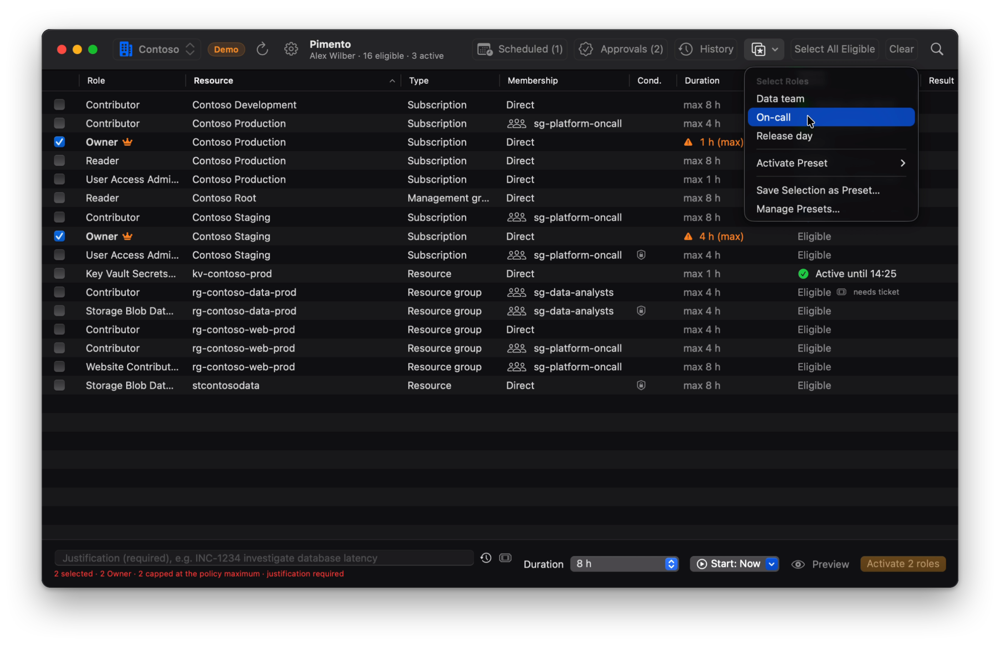

**Results per row, including approvals.** Roles that need approval show *Awaiting approval*;
Pimento follows the request and notifies you when it is decided.

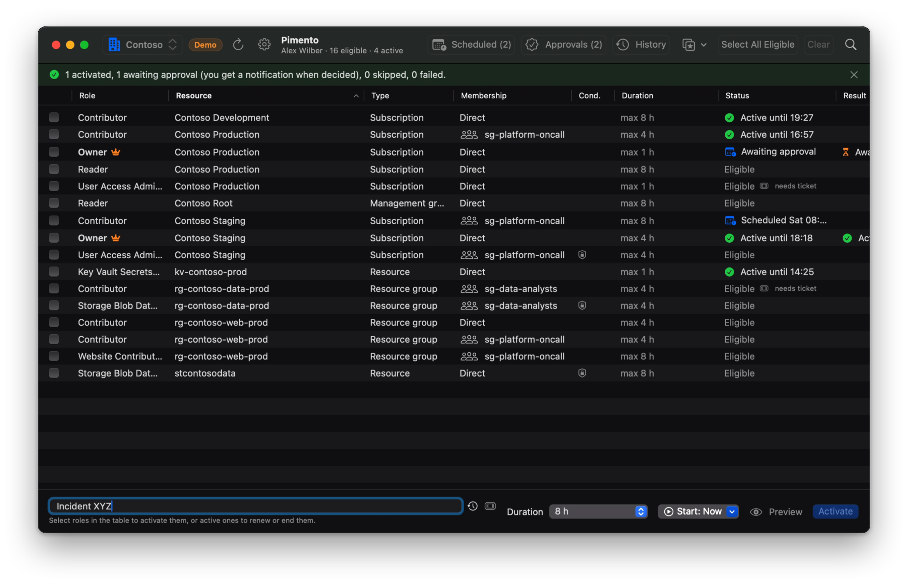

**Approvals inbox.** As an approver, approve or deny requests in bulk with a justification;
requests for Owner or access-administrator roles are flagged.

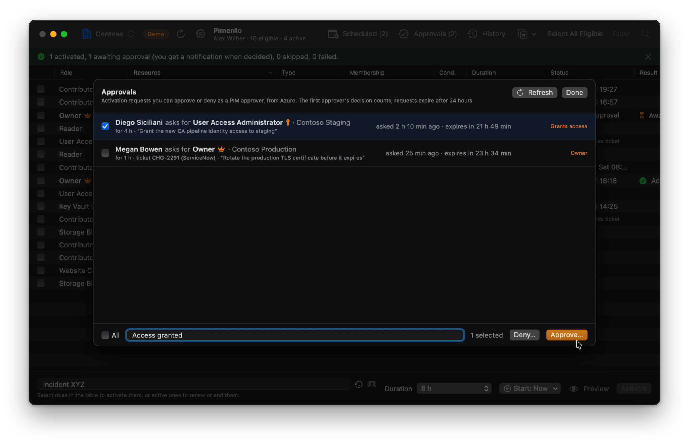

**History.** Every request from the app and the CLI, searchable and filterable by period,
action, outcome and tenant, with CSV export and import from Azure.

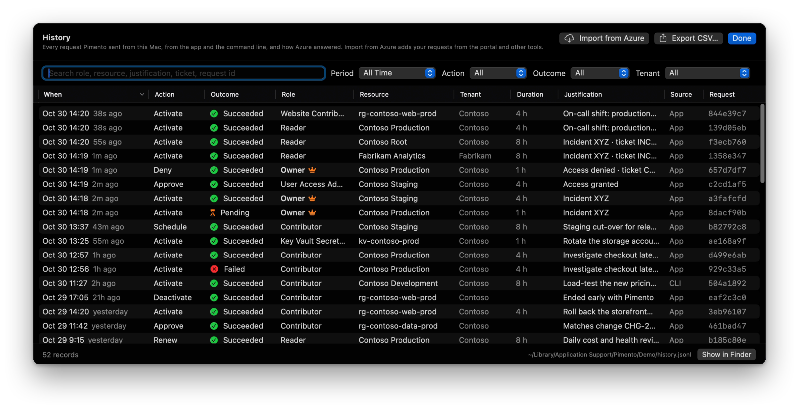

**Settings › Appearance.** Pick a theme from preview cards and a mode: system, light, dark,
ultra dark or by time of day.

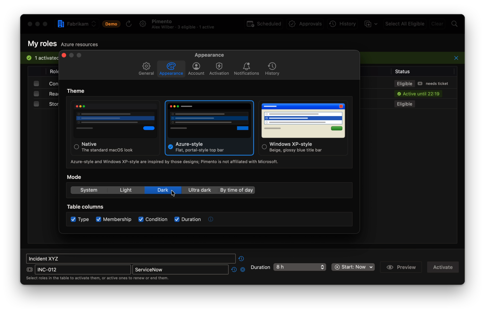

**Themes.** Native (here in ultra dark), Azure-style and, for fun, Windows XP-style.

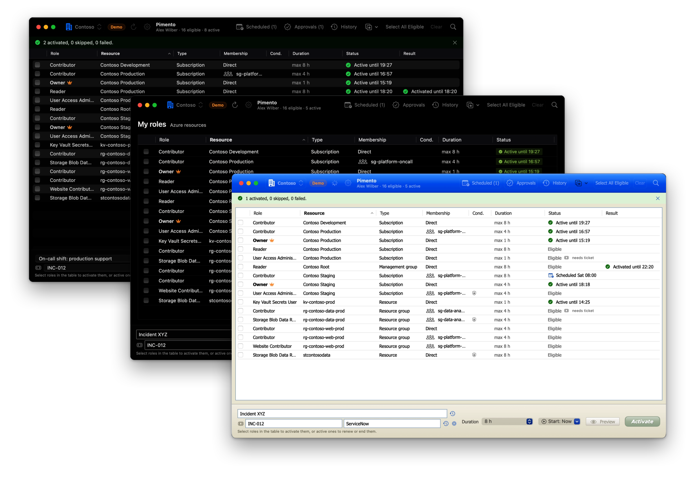

**Scheduled activations.** Activations that start later, straight from Azure, with *Cancel*.

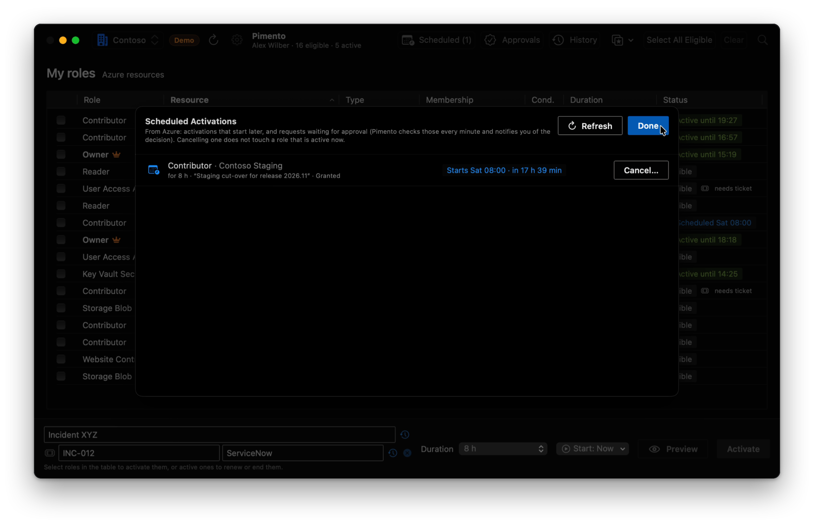

**The command line.** The same features in `pimento`, on macOS, Linux and Windows: here an Owner
activation, capped at the policy maximum, confirmed and waiting for approval. More in
[The command line](#the-command-line).

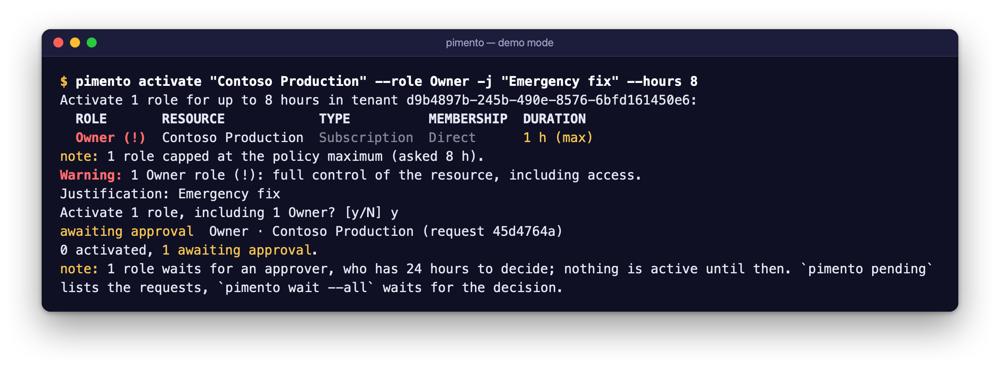

The Azure-style and Windows XP-style themes are inspired by those designs; Pimento is not
affiliated with or endorsed by Microsoft.

## Requirements

- macOS 14 Sonoma or later for the app; the `pimento` CLI also runs on **Linux** (x86_64 and
  arm64, glibc 2.35+: Ubuntu 22.04, Debian 12, RHEL 9 or later, with libcurl) and **Windows** 10/11
  (x86_64), see [Linux and Windows](#linux-and-windows)
- [Azure CLI](https://learn.microsoft.com/cli/azure/install-azure-cli-macos) (`brew install azure-cli`), signed in with `az login`,
  **or** an app registration for [Pimento sign-in](#pimento-sign-in-without-the-azure-cli) (no Azure CLI needed)
- To build: Swift 6.0 or later (Xcode 16+, or just the Command Line Tools: `xcode-select --install`;
  on Linux and Windows the [swift.org toolchain](https://www.swift.org/install/), CLI only)

## Usage

### The app

1. Make sure `az` is signed in: `az login` (or `az login --tenant <tenant>`).
2. Open Pimento. It loads your eligible roles for the selected tenant.
3. Filter with the search field, check rows, or press <kbd>⇧</kbd><kbd>⌘</kbd><kbd>A</kbd> to select every
   role that is not active yet (within the current filter). Checking an *active* row selects it
   for **Renew** / **Deactivate** instead (see below).
4. Enter a **justification** and a **duration**: 1 to 24 hours (default 8), or *Maximum allowed*.
   Each role is requested for at most its PIM policy's maximum; the **Duration** column shows the
   maximum of every role and, for checked rows, the duration it will get.
   **Start** is *Now*, or a later time: the button then reads **Schedule N roles** (see
   [Scheduled activations and tickets](#scheduled-activations-and-tickets)). When a checked role's
   policy requires a ticket, fill in the ticket number and system that appear under the justification.
5. Press **Activate** (<kbd>⌘</kbd><kbd>↩</kbd>) to send the requests; Owner roles ask for confirmation
   first (a setting, on by default). **Preview** (<kbd>⌥</kbd><kbd>⌘</kbd><kbd>↩</kbd>) shows the request bodies instead, with
   *Copy All*, and sends nothing. The list refreshes afterwards.

| Shortcut | Action |
| --- | --- |
| <kbd>⌘</kbd><kbd>R</kbd> | Refresh |
| <kbd>⇧</kbd><kbd>⌘</kbd><kbd>A</kbd> | Select all eligible (within the filter) |
| <kbd>⇧</kbd><kbd>⌘</kbd><kbd>D</kbd> | Clear selection |
| <kbd>⌘</kbd><kbd>K</kbd> | Clear results |
| <kbd>⇧</kbd><kbd>⌘</kbd><kbd>T</kbd> | Choose tenant |
| <kbd>⌘</kbd><kbd>1</kbd> … <kbd>⌘</kbd><kbd>9</kbd> | Select the roles of the first nine presets |
| <kbd>⇧</kbd><kbd>⌘</kbd><kbd>S</kbd> | Save selection as preset |
| <kbd>⌘</kbd><kbd>↩</kbd> | Preview / activate |
| <kbd>⇧</kbd><kbd>⌘</kbd><kbd>R</kbd> | Renew the checked active roles |
| <kbd>⇧</kbd><kbd>⌘</kbd><kbd>E</kbd> | End the checked active roles now |
| <kbd>⇧</kbd><kbd>⌘</kbd><kbd>L</kbd> | Scheduled activations |
| <kbd>⇧</kbd><kbd>⌘</kbd><kbd>P</kbd> | Approvals (requests you can approve or deny) |
| <kbd>⌘</kbd><kbd>F</kbd> | Filter |

### Ending and renewing activations

Check active rows and the bottom bar offers **Renew** and **Deactivate**; right-clicking a row
offers *End Now…* and *Renew…* for it (or for all checked active rows when it is one of them).
Both ask first. The same actions are in the menu bar (<kbd>⇧</kbd><kbd>⌘</kbd><kbd>R</kbd>, <kbd>⇧</kbd><kbd>⌘</kbd><kbd>E</kbd>).

| Action | What Pimento sends | What happens |
| --- | --- | --- |
| **Deactivate** (End Now) | `SelfDeactivate` | The activation ends; the row goes back to *Eligible*. PIM refuses this in the first **5 minutes** after an activation; Pimento then shows *Too soon* with the time from which it works, and sends nothing. |
| **Renew** | `SelfDeactivate`, then `SelfActivate` | A fresh activation for the chosen duration (capped at the policy maximum). **In between the role is not active**: PIM accepts the new activation only once it has removed the old one, which took about **3 minutes** in tests. Pimento keeps trying for 5 minutes and shows *Activating again (try n)…*. If that fails, the role stays off: activate it again. Roles whose policy requires approval, or whose policy cannot be read, are not renewed. The new activation carries the ticket the current one was requested with (or the one in the ticket fields / `--ticket`); a role whose policy requires a ticket is skipped when none is known. |
| `pimento extend` (CLI) | `SelfExtend` | For **admin-assigned, time-bound** assignments: a *request* that an administrator must approve (`PendingAdminDecision`). Nothing changes until then. |

**Why Renew and not Extend?** PIM has no self-service way to lengthen your own activation.
Sending `SelfExtend` for an activation is accepted, but only as a request for an administrator
(`PendingAdminDecision`), and PIM keeps the old end time in it. Pimento therefore renews
activations, and uses `SelfExtend` only for admin-assigned time-bound assignments (where it is
the documented way to ask for more time).

Rows you end or renew keep their new state while Azure catches up (a refresh follows right away
and again after 20 and 60 seconds), the result column says what happened, and the completion
notification sums it up. Reminders for ended roles are withdrawn; renewed roles get new ones.

**From the expiry reminder.** The reminder has two actions:

- **Renew** renews the roles in the reminder for the duration they were activated for, with
  the same justification when Pimento keeps recent justifications (Settings › Activation). If
  there is no justification, or the roles include Owner (with the Owner confirmation on), the app
  comes forward and asks.
- **End Now** ends them right away; with an Owner role (and the Owner confirmation on), the app
  comes forward and asks first.

Both act in the tenant and for the account the reminder is for; if the app shows another tenant,
or another account is signed in, it says so instead. Signing an account out removes its reminders.
Both need an unlocked Mac: on the lock screen, macOS asks for your password or Touch ID first.

### Keep alive

Long sessions should not drop out. Right-click active rows and pick **Keep Alive** (or turn on
*Keep alive* for a preset under **Manage Presets…**), and Pimento renews those roles before they
expire, during your working hours, for as long as it runs. Kept roles show a
circular-arrows icon in the Status column and in the menu bar, with what happens next in the
tooltip (*Kept alive: renews at 15:25*, *continues at 15:40 until 18:00*, *not possible: its policy
requires approval*). The **Keep Alive** toolbar menu lists them and has **Pause Keep Alive** and
**Check Now**; the menu bar popover has a *Pause* / *Resume* line.

**How a role is continued, and the gap.** PIM has no self-service way to lengthen an activation
(`SelfExtend` and `SelfRenew` are requests an administrator must approve, see
[Ending and renewing](#ending-and-renewing-activations)), and *Renew* leaves the role off for a few
minutes. But PIM accepts a scheduled `SelfActivate` while the role is active, for a start after the
current activation ends (see [Scheduled activations](#scheduled-activations-and-tickets)). So 15
minutes before a kept role ends, Pimento schedules its next activation to start **exactly when the
current one ends**: one request, nothing is ended, and there is no gap beyond the moment PIM takes to
switch. The continuation appears under **Scheduled** until it starts (and can be cancelled there).
Starting it any earlier would overlap the current activation, which PIM refuses
(`RoleAssignmentExists`). This hand-over has been checked against Microsoft's documentation and the
demo simulator, not yet against a live tenant: if PIM refuses it or the continuation does not start,
Pimento activates the role again once it has ended, and then there **is** a gap (seconds to minutes).

**The rules.**

| | |
| --- | --- |
| When | Only inside working hours (Settings › Activation › Keep alive: days, from, until; local time; Mon–Fri 08:00–18:00 by default; an end at or before the start runs overnight). Outside them nothing is sent. |
| How long | Each renewal asks for the preset's duration, or the longest the role's policy allows, capped at the policy maximum like any activation. |
| End of the day | Never past the end of working hours: the last renewal is shortened to end by then, in whole hours (or the policy maximum when that is shorter, e.g. 90 minutes). When not even that fits (say 40 minutes are left), the role is left to end. |
| Justification and ticket | The new activation carries the justification and ticket of the one it continues (read from your requests); a preset's justification is used when that is unknown. When the policy requires a ticket (or a justification) that is not known, the renewal is skipped and you get a notification. |
| Approval | Roles whose policy requires approval are never renewed (the role would wait for an approver); neither are roles whose policy cannot be read. Policies are read again every hour, and a request of yours that waits for an approver stops further renewals of that role. The context menu and the tooltip say so. |
| Roles that grant access | With *Confirm before activating Owner roles* on (the default), marking an Owner, User Access Administrator or RBAC Administrator role as Keep Alive, directly or by turning on a preset's keep-alive, asks once, when it is marked. A role a preset picks up later without that confirmation is not renewed (*not confirmed*) until you mark it. `pimento keep-alive` asks at its prompt (only the roles listed there count), or takes `--yes` as consent, as `activate` does. |
| Ended early | A role you end (*End Now*, the CLI, the portal) is not brought back, and a continuation scheduled for it is withdrawn. Pimento notices from the role listing and from your requests (a `SelfDeactivate` after the activation started), so also after sleep, a restart, or when another Pimento scheduled the continuation; it looks again two minutes before each continuation starts. A role ended in those last two minutes while Pimento is not looking may still be continued: end it again. Turning keep-alive off for a role, or pausing, withdraws continuations that have not started. |
| Sleep, closed app | A role that lapsed while the Mac slept (or Pimento was not running) is activated again when Pimento looks next, if it is still inside working hours and the role ended inside them: on wake, after a clock or time-zone change, and at least every 30 minutes. Keep-alive never starts a role that was not active. |
| Failures | Retried after 1, 5 and 15 minutes; after 4 failures for a role it waits for the next working hours. Each failure is a notification. |

**Notifications** follow Settings › Notifications › *When activations finish*: *Renewed Contributor
until 18:00* for each renewal (or only failures and skipped renewals with *Only when something
fails*). Expiry reminders of a continued role are withdrawn; the last renewal of the day gets one.
Continuations get no *Scheduled activation started* notification. Every request keep-alive sends
(continuations, re-activations, withdrawn continuations) is recorded in the [history](#history)
with the source **Keep alive** (`keepAlive` in the file, the CSV export and `--json`), from the app
and from `pimento keep-alive` alike.

**From a terminal:** `pimento keep-alive` runs the same rules as a foreground loop (Linux, Windows, a
server, or without the app), until Ctrl-C. See [The command line](#the-command-line).

### Scheduled activations and tickets

**Scheduling.** The **Start** menu in the bottom bar offers *Now*, *In 1 hour*, *Tomorrow 08:00*,
*Next working day 08:00* (Monday to Friday) and *Pick Date and Time…* (your local time zone). With a
later start the button reads **Schedule N roles** and Pimento sends a normal `SelfActivate` whose
`scheduleInfo.startDateTime` is that time. What PIM does with it, as tested:

- It accepts the request with status `Granted` and activates the role at the start, for the
  chosen duration (capped at the policy maximum as usual). Roles that need approval wait for it.
- It accepts a start up to **a month** ahead; later ones fail with `ScheduleStartTimeTooFarAhead`.
  Pimento offers up to 30 days.
- It also accepts a schedule for a role that is **active now**, for a start after the current
  activation ends (the CLI schedules such roles; one still active at the start is skipped).

The result column says *Scheduled for Fri 08:00*, and the start goes back to *Now* once a batch
was scheduled. **Scheduled** in the toolbar (<kbd>⇧</kbd><kbd>⌘</kbd><kbd>L</kbd>) lists your activations that
have not started and requests waiting for approval, read from Azure
(`roleAssignmentScheduleRequests`, `$filter=asTarget()`), so it includes requests made in the
portal or with the CLI. **Cancel…** on a row and **Cancel All…** ask first, naming the requests,
and send only those (not what a refresh added meanwhile); switching the account or tenant closes
the question. Cancel sends `POST …/roleAssignmentScheduleRequests/{id}/cancel`; a
request that started or was decided meanwhile cannot be cancelled (`RequestCannotBeCancelled`):
end an active role with *Deactivate*. Eligible rows with a pending request show *Scheduled Fri 08:00*
or *Awaiting approval*; active ones a calendar icon.

With **Notify when a scheduled activation starts** (Settings › Notifications, on by default)
Pimento schedules a local notification for each start time. It is rebuilt whenever the list is
read, so a request cancelled anywhere loses its notification at the next refresh. It is
best-effort: macOS shows it at the start time without checking that PIM activated the role.

**Tickets.** When a role's PIM policy has *Require ticket information on activation*
(`Ticketing` in the end-user enablement rule), its row says **needs ticket** and, once it is checked,
**ticket number** and **ticket system** fields appear under the justification; the button stays
disabled until both are filled in. Any activation can carry a ticket: the ticket button next to
the justification shows the fields. Pimento sends `ticketInfo: {ticketNumber, ticketSystem}` with
every request of the batch, remembers the last ticket system, and offers recent tickets from the
clock button (with *Remember recent justifications and tickets*). A preset can store a default
ticket system. If PIM still answers with a `TicketingRule` failure, the result says
*a ticket is required: give a ticket number and ticket system*.

### Approvals

**When your role needs approval.** PIM answers the activation with `PendingApproval`: the row
says *Awaiting approval* (hourglass), the completion notification lists it apart, and no expiry
reminder is set. The request appears under **Scheduled** with when you asked and when it expires
(an approver has **24 hours**, then PIM lets it time out); *Cancel* withdraws it. While any request
waits, Pimento reads your requests every minute (`roleAssignmentScheduleRequests`, `asTarget()`;
not when auto-refresh is set to 1 minute, which reads them anyway; paused during an activation)
and stops once none is left. When one is decided you get a notification:

- **Approved**: *Approved and active: Contributor*, with the end of the activation; the row turns
  active and gets its expiry reminder.
- **Denied**: with the approver's justification and name, when Azure lets you read the approval
  (`roleAssignmentApprovals/{id}/stages`; if not, without them).
- **Expired** (`TimedOut`) or **cancelled**.

**When you are an approver.** **Approvals** in the toolbar (<kbd>⇧</kbd><kbd>⌘</kbd><kbd>P</kbd>; it reads
*Approvals (2)* when two wait) lists the requests you may decide: requester, role, resource,
duration and start, justification, ticket, when it was asked and when it expires. Check one or more
(or *All*), enter a justification (required; the requester sees it) and press **Approve** or
**Deny**. Deny always asks first; Approve asks when roles that can grant access are among them:
Owner, User Access Administrator or Role Based Access Control Administrator, marked in the list
(with *Confirm before activating Owner roles* on). Each row shows *Sending…*, then *Approved* / *Denied*, or why not (for
example decided by another approver meanwhile). The first approver's decision counts, and you
cannot approve your own requests. Without approver permissions the sheet simply says *You have no
approvals to review*. The list is read whenever Pimento refreshes; with *New approval requests* on
(Settings › Notifications), new ones get a notification that opens the sheet. For timely
notifications, turn on auto-refresh (Settings › General).

### History

Pimento keeps a log of every request it sends, from the app and from the `pimento` CLI:
activate, schedule, cancel, deactivate, renew, extend, approve and deny. Each entry holds the time,
the tenant (ID and name when known), role, resource and scope, the outcome (*Succeeded*, *Pending*,
*Skipped*, *Failed*, with Azure's status or error code and a short message), the duration asked for
and the one requested after the policy cap, the start, the justification, the ticket, the request ID,
where it came from (app, CLI, keep-alive, `mcp` for [AI agents](#ai-agents-mcp), or Azure) and the Pimento version. Never tokens, and never request or response
bodies. A renewal is one entry however many attempts it took. Previews and dry runs are not recorded.

**History…** (<kbd>⇧</kbd><kbd>⌘</kbd><kbd>H</kbd>, the toolbar or the View menu) shows it as a table, newest
first, sortable by any column. Search (role, resource, justification, ticket, request ID), pick a
period (last 24 hours to last year, all time, or a custom range of days) and filter by action,
outcome and tenant. **Export CSV…** saves the rows shown, as filtered and sorted. Right-click a row
for **Activate Again** (checks that role and fills in its justification, ticket and duration; you
still press Activate) or **Copy Request ID**.

**Import from Azure** reads your own past requests in the current tenant
(`roleAssignmentScheduleRequests`, `$filter=asTarget()`, read-only) and adds the ones the history
does not have yet, marked *Azure*: activity from the portal or other tools shows up too. Requests are
matched by request ID, so importing twice adds nothing. Only your self-service requests are taken
(activate, deactivate, extend, renew), not assignments an administrator made.

**Settings › History** turns recording on or off (on by default), sets how long entries are kept
(30, 90 or 365 days, or forever; 1 year by default), shows the file in Finder and clears it (asks
first). The CLI follows the same settings.

#### History file

`~/Library/Application Support/Pimento/history.jsonl`, shared by the app and the CLI
(`PIMENTO_HISTORY` points both elsewhere, for the CLI or an app started from a terminal; on Linux
and Windows see [Linux and Windows](#linux-and-windows)). It is
[JSON Lines](https://jsonlines.org): one object per line, mode 600. Every write takes an exclusive
lock on the file (on Windows, on `history.jsonl.lock` next to it) and appends each line with a
single write on an append-only descriptor, so the app and the CLI can write at the same time. Past 5 MB the file becomes `history.1.jsonl` (replacing
an older one) and a new one starts. Entries older than the retention are removed when Pimento
starts, when it first records something, and when the retention changes. The settings are in
`history-settings.json` next to it (`{"enabled": true, "retentionDays": 365}`, 0 = forever).
Readers ignore fields they do not know and skip lines they cannot read.

```json
{"action":"activate","at":"2026-10-29T08:00:03.120Z","durationMinutes":240,"end":"2026-10-29T12:00:02.000Z","id":"5b3e…","justification":"CHG-1001 release 2.4","requestId":"7a1b2c3d-0000-4000-8000-000000000002","requestedDuration":"PT8H","result":"succeeded","roleDefinitionId":"/subscriptions/…/roleDefinitions/b24988ac-6180-42a0-ab88-20f7382dd24c","roleName":"Contributor","scope":"/subscriptions/bbbbbbbb-0000-0000-0000-00000000000b","scopeName":"Contoso Staging","scopeType":"subscription","source":"app","start":"2026-10-29T08:00:02.000Z","status":"Provisioned","tenantId":"11111111-2222-4333-8444-555555555555","tenantLabel":"Contoso","ticketNumber":"CHG-1001","ticketSystem":"ServiceNow","v":1,"version":"0.1.0"}
```

The CSV export is [RFC 4180](https://www.rfc-editor.org/rfc/rfc4180): UTF-8, a header row, CRLF line
ends, every field quoted. Columns: `timestamp_utc` (ISO 8601),
`local_time`, `action`, `result`, `status`, `message`, `tenant_id`, `tenant`, `role`, `resource`,
`scope`, `requested_duration`, `duration_minutes`, `start_utc`, `end_utc`, `justification`,
`ticket_number`, `ticket_system`, `request_id`, `requester` (approve/deny), `source` (`app`, `cli`,
`keepAlive`, `azure`), `pimento_version`. Text that starts with `=`, `+`, `-`, `@`, a tab or a carriage return gets a `'` in
front, at the start of a field and after every `;` or tab inside it, so a spreadsheet does not run
it as a formula, even one that splits cells on `;` (the list separator of many locales). The file is
written with mode 600.

### Presets

A preset is a named set of eligibilities, with an optional justification and duration. Use the
**Presets** button in the toolbar or the **Presets** menu:

- **Save Selection as Preset…** (<kbd>⇧</kbd><kbd>⌘</kbd><kbd>S</kbd>) saves the checked roles, and
  optionally the justification and duration.
- Picking a preset (<kbd>⌘</kbd><kbd>1</kbd>…<kbd>⌘</kbd><kbd>9</kbd>) checks exactly its roles and fills in its
  justification and duration. A banner says which of its roles are already active and which you are
  no longer eligible for. **Activate Preset** does the same and activates right away; Owner roles
  still ask first when that setting is on.
- **Manage Presets…** renames, edits and deletes presets (including a default ticket system): tick roles in the list of your current
  eligibilities (active ones too), remove roles that no longer exist, or replace the roles with
  the checked ones.

Presets are saved per tenant; the menu shows the presets of the tenant you are looking at.
A role is identified by its scope and role definition, so a preset keeps working after renames.
The app and the `pimento` CLI share one file (see [Preset file](#preset-file)).

### Menu bar

Pimento shows a pepper-shield icon in the menu bar (Settings › General › Menu bar › *Show in menu bar*, on by
default). While roles are active, the number of them follows the icon; with *Show remaining time in
menu bar* the soonest end too: `1:24` for one role, `2 · 1:24` for more (hours:minutes, a day or more as
`2d 3h`). Click the icon for:

- **Active roles**, soonest end first (one row per scope + role, also when you hold it directly and
  through a group), with a countdown that ticks every second while the popover is open. A role ending
  within the expiry-reminder lead time (Settings › Notifications) shows in the warning colour.
  **Renew** and **End Now** on each row ask first, inline, with the same text as the main window's
  confirmations; Renew shows the justification to send (and needs one). Roles whose renewal needs a
  ticket are left to the main window, which has the ticket fields.
- **Presets** of the current tenant, with **Activate**: it selects the preset's roles (like the Presets
  menu) and activates them now, with the preset's justification and duration. A preset without a
  justification asks for one first (unless one is already typed in the window); Owner roles still ask
  when that setting is on. A start time picked in the window is reset, as the popover always activates now.
- **Scheduled (N)** and **Approvals (N)** open those views in the main window; requests of yours
  awaiting approval are counted.
- **Open Pimento** (<kbd>⌘</kbd><kbd>O</kbd>), **Refresh** (<kbd>⌘</kbd><kbd>R</kbd>), **Settings…** and **Quit**.

The popover follows the theme and mode (Native on the system material, Azure-style with its dark top
bar, Windows XP-style with the blue title band, ultra dark in black). Refreshing works as in the window:
on launch (when that is on), automatically (Settings › General › Refresh), after each change, and on
Refresh; opening the popover loads the roles only if nothing was loaded yet. One timer drives every
countdown: each second while the popover is open; otherwise only when the menu bar text changes (about
once a minute with the remaining time shown, at each expiry without it), and none without active roles.

With the menu bar icon shown, closing the window keeps Pimento running; **Open Pimento** brings it back.
*Hide Dock icon (menu bar only)* removes the Dock icon and the app menu (applied right away and at
launch); it applies only while the menu bar icon is on, so Pimento never becomes unreachable. Without
the menu bar icon, closing the window quits, as before. ⌘-drag the icon out of the menu bar to turn
*Show in menu bar* off.

*Launch at login* registers Pimento.app as a login item (`SMAppService`). It needs the bundled app
(`scripts/bundle.sh --install`); macOS may refuse an ad-hoc signed build, and Settings then shows the
system's reason. If it does, add Pimento under System Settings › General › Login Items. A login item
that is switched off there shows a note.

### Choosing the tenant

Pimento talks to one Microsoft Entra tenant at a time. It uses the first of:

1. `--tenant <id-or-domain>` on the command line (also for the app: `open -a Pimento --args --tenant contoso.onmicrosoft.com`)
2. the `PIMENTO_TENANT` environment variable
3. the tenant you picked in the app's toolbar (remembered), or the one set under
   **Settings › General › Open with**
4. the tenant of az's current account (`az account show`), or with
   [Pimento sign-in](#pimento-sign-in-without-the-azure-cli) the tenant you signed in to

The `pimento` CLI uses 1, 2 and 4: it does not read the app's tenant settings.

The tenant picker (<kbd>⇧</kbd><kbd>⌘</kbd><kbd>T</kbd>, or click the tenant in the toolbar) lists every
tenant your login can reach, sorted by name, with the domain and a short ID underneath. Type to
search; <kbd>↩</kbd> picks the first match. Hover over a tenant and click the eye to hide it from the
list (*Show hidden* brings it back). Names come from ARM's `GET /tenants`, filled in from
`az account list --all` and `az account tenant list`; a tenant none of them names shows as
*Unnamed tenant* with the start of its ID. *Enter ID or Domain…* takes any tenant ID or domain.
With `--tenant` or `PIMENTO_TENANT` the picker is locked and says why.

Each tenant has a **badge** in the picker, the toolbar, the menu bar and the tenant menus of Settings
and History: one or two initials on a colour that stays the same for that tenant ID. The initials
come from the display name (*Northwind Traders* → *NT*, *Contoso* → *C*) without legal forms such
as *SE*, *GmbH*, *& Co. KG*, *Inc.* or *Ltd* and without bracketed parts; Chinese, Japanese and
Korean names get one character, and a tenant without a name uses its domain. The badge is drawn
on the Mac, with nothing sent. With **Settings › General › Fetch tenant logos** (off by default)
Pimento shows the tenant's logo instead, where it finds one: the square logo of the tenant's
Microsoft sign-in page, else the icon of its website (see [Security and privacy](#security-and-privacy)).

### Pimento sign-in (without the Azure CLI)

By default Pimento borrows the token of your Azure CLI session. If you do not have (or want) the
Azure CLI, Pimento can sign you in by itself with the Microsoft identity platform, as a **public
client**: no client secret, no certificate, no service principal permissions. It acts as you, with
the delegated *Azure Service Management* permission, exactly like the portal. You need the
Application (client) ID of an app registration; Pimento ships none and does not borrow Microsoft's
own client IDs.

#### Register the app (once, in Microsoft Entra ID)

1. Open the [Microsoft Entra admin center](https://entra.microsoft.com) › **Identity › Applications ›
   App registrations › New registration**. You need a role that may register applications
   (by default every member may; otherwise *Application Developer*).
2. **Name**: for example `Pimento`. **Supported account types**: *Accounts in this organizational
   directory only* for one tenant, or *Accounts in any organizational directory (Multitenant)* if you
   want to use Pimento in other tenants too (as a guest, for example).
3. **Redirect URI**: platform **Public client/native (mobile & desktop)**, value `http://localhost`.
   Press **Register**. (Pimento listens on `http://localhost:<random port>`, on both 127.0.0.1 and
   ::1, and picks another port when another program holds either side; Entra ignores the port of a
   `localhost` redirect URI. `http://127.0.0.1` is not used: Entra documents the ignored port only
   for `localhost`, and an `http://127.0.0.1` URI can be added only by editing the manifest.)
4. **Authentication**: check that the platform **Mobile and desktop applications** lists
   `http://localhost` (if not: *Add a platform* › *Mobile and desktop applications* › custom redirect
   URI `http://localhost` › *Configure*). Under **Advanced settings**, set **Allow public client
   flows** to **Yes** (needed for the device code) and **Save**.
5. **API permissions** › **Add a permission** › **Azure Service Management** › **Delegated
   permissions** › `user_impersonation` › **Add permissions**. (`openid`, `profile` and
   `offline_access` are requested at sign-in and need no entry.) If users in your tenant may not
   consent to apps, an administrator clicks **Grant admin consent**.
6. **Overview**: copy the **Application (client) ID**. Do not create a client secret or
   certificate: Pimento does not use one.

For a multi-tenant registration, each other tenant consents on first sign-in there (or its
administrator grants consent); the app then shows up under *Enterprise applications* in that tenant.

#### Sign in

- **App**: Settings › **Account** › paste the client ID › **Sign In…** (opens your browser) or
  **Sign In with Code…** (shows a code to enter at `https://microsoft.com/devicelogin` on any
  device, with *Copy Code* and *Open Page*). Signing in makes *Pimento sign-in* the auth source;
  the radio buttons switch back to the Azure CLI at any time. The main window offers both when
  you are signed out.
- **CLI**:

  ```sh
  pimento login --client-id 00000000-0000-0000-0000-000000000000   # browser
  pimento login --device-code                                       # SSH, headless: a code to enter elsewhere
  pimento whoami                                                    # auth source, account, tenant
  pimento list --auth az                                            # this once with the Azure CLI
  pimento logout                                                    # or --all
  ```

Where tokens come from: `--auth az|pimento` (CLI, any command), else `$PIMENTO_AUTH`, else the
saved choice (Settings › Account, or `pimento login`), else the Azure CLI. The client ID:
`--client-id`, else `$PIMENTO_CLIENT_ID`, else the saved one. `pimento logout` of the last account
switches back to the Azure CLI; *Sign Out* in the app keeps the choice so you can sign in again.
Both share the settings file `auth.json` next to the presets (source, client ID, chosen account,
and a pending claims challenge; no secrets).

**Tenants.** You sign in once, to your home tenant (or `--tenant` / the tenant picked in the app).
Switching tenants in the picker, `--tenant` or `$PIMENTO_TENANT` redeems the refresh token for that
tenant: no new sign-in, as long as you are a member or guest there and the app is consented there.
The tenant picker lists the tenants of your account from ARM's `GET /tenants`.

**MFA and Conditional Access.** When Microsoft asks for more (MFA, a compliant device, an
authentication context for a role), Pimento says so in plain words (*Multi-factor authentication is
required … (AADSTS50076)*) and asks you to sign in again. A claims challenge that comes with the
error, or with an activation that needs an authentication context, is kept and sent with the next
browser sign-in, so the new token carries what was asked for.

**How it works.** Browser: OAuth 2.0 authorization code flow with PKCE (S256), `state` and `nonce`,
against `https://login.microsoftonline.com/<tenant or organizations>/oauth2/v2.0/`. A one-shot
HTTP listener on 127.0.0.1 (and ::1) on a random port receives the redirect, checks `state`,
answers *You can close this tab* and stops; it gives up after 5 minutes. Device code: the
documented polling, with `authorization_pending`, `slow_down` (5 seconds more each time) and
expiry. Scopes: `https://management.azure.com/user_impersonation offline_access openid profile`.
Access tokens (about an hour) stay in memory, per account and tenant, and are renewed five minutes
before they expire, computed from `expires_in` on this Mac's clock (a skewed clock does not make a
fresh token look expired). The name and IDs in *Signed in as …* come from the id token
(`oid`, `tid`, `preferred_username`, `name`).

**Where the refresh token is kept.**

- **macOS**: the login **Keychain**, a generic password per account, service
  `io.github.melvin2306.pimento`, account `<object id>.<home tenant id>`, accessible after first
  unlock, this device only (not synced). The account's name is stored in the item's attributes, so
  listing accounts reads no secret. The app and the CLI share the items. Pimento is signed ad hoc,
  so macOS ties the item to the exact binary that created it: the first time the other binary (the
  CLI after signing in in the app, or the reverse), or a new build after an update, reads it, macOS
  asks for your login password (*Always Allow* stops the question until the next update). To avoid
  that for the CLI, set `PIMENTO_TOKEN_STORE=file`.
- **Linux**, or `PIMENTO_TOKEN_STORE=file` on macOS: `~/.config/pimento/tokens.json`
  (`$XDG_CONFIG_HOME/pimento`, or `$PIMENTO_TOKEN_FILE`), mode 600 in a folder with mode 700.
  **Less secure** than the Keychain: any program running as you can read it.
- **Windows**: `%APPDATA%\Pimento\tokens.json` (or `$PIMENTO_TOKEN_FILE`). Windows has no POSIX
  modes: the file is protected only by your user profile's permissions, like the rest of `%APPDATA%`.

`pimento logout` / *Sign Out* delete the item (or the file's entry). Microsoft revokes refresh
tokens on password changes and when an administrator revokes your sessions; Pimento then asks you
to sign in again.

### Settings

<kbd>⌘</kbd><kbd>,</kbd> opens Settings: one toolbar tab per pane, each pane two columns of grouped
options, with an ⓘ button where an option needs more explanation. Changes apply immediately;
*Reset All Settings to Defaults* is under General.

| Tab | Options |
| --- | --- |
| General | tenant to open with (last used, az's current, or a specific one); unhide hidden tenants; fetch tenant logos (off by default; *Refresh Logos*, *Clear Cache*, see [Security and privacy](#security-and-privacy)); load roles on launch; refresh automatically (off, 1, 5 or 15 minutes); menu bar icon (on by default), its remaining time, hide the Dock icon, launch at login (see [Menu bar](#menu-bar)); check for updates automatically (on by default), *Check Now* and what the last check found (see [Updates](#updates)) |
| Appearance | theme, picked from preview cards; mode (see [Themes](#themes)); show or hide the Type, Membership, Condition and Duration columns (also via right-click on a column header) |
| Account | sign in with the Azure CLI or Pimento sign-in; the client ID of your app registration; signed-in accounts (*Use*, *Sign Out*, *Sign Out All*); *Sign In…* (browser) and *Sign In with Code…* (see [Pimento sign-in](#pimento-sign-in-without-the-azure-cli)) |
| Activation | default duration; parallel requests (1 to 16, default 8); confirm before activating Owner roles (on by default); remember recent justifications and tickets and offer them from the clock buttons next to the fields; start with the last justification filled in; keep alive: pause, working days and hours (Mon–Fri 08:00–18:00 by default, see [Keep alive](#keep-alive)) |
| History | keep a history (on by default); keep records for 30, 90 or 365 days or forever; the file, Show in Finder, Clear History |
| Notifications | macOS permission state, with a shortcut to System Settings when it is off; send a test notification; notify when activations finish, or only when something fails; expiry reminders and how long before (5, 10, 15 or 30 minutes); notify when a scheduled activation starts; approval decisions on your requests; new approval requests for you; sound |

### Updates

Once a day, at launch or while it runs, Pimento asks GitHub for the latest release and compares it
with its own version (semantic versioning; drafts and pre-releases are ignored). When a newer one
exists, a one-line notice above the role table and in the menu bar says *Pimento 0.2.0 is
available*, with **Download** (the release's `Pimento.dmg` in your browser) and **Release Notes**
(the release page). Open the disk image and drag Pimento onto Applications to replace the old one;
your settings, presets, history and sign-in stay. The ✕ hides the notice until the next version.

- **Pimento › Check for Updates…** checks now and says what it found; *Settings › General ›
  Updates* has *Check Now*, the time and result of the last check, and the switch for the daily
  check (on by default). A manual check works with the switch off.
- **The CLI** never checks on its own: `pimento version --check` asks and prints the current and
  latest versions and how to update (re-run the [installer](#install-the-command-line-tool) for the
  version it found, `--version X` / `PIMENTO_VERSION`; the CLI inside Pimento.app is updated with the app).
- **Turn it off everywhere** with `PIMENTO_NO_UPDATE_CHECK=1` (in the environment of the app, for
  example with `launchctl setenv`, or of the CLI). Demo mode never checks.

Nothing is downloaded or installed automatically. What is sent is under
[Security and privacy](#security-and-privacy).

### Themes

*Settings › Appearance* switches the look of the main window, its sheets, the tenant
picker and the Settings window. The change applies right away. Only the styling changes: every
control, shortcut and accessibility label works the same in each theme.

| Theme | Look |
| --- | --- |
| Native (default) | The standard macOS look. |
| Azure-style | Flat and blue: the title bar and toolbar form one near-black portal-style top bar, with a "My roles" page title below it, the table on a white card with light-blue checked rows, portal-style status badges, square blue buttons. Light and dark. Uses Segoe UI if the Mac has it, otherwise the system font. |
| Windows XP-style | Beige window under a glossy blue title bar (the toolbar itself), a white list box with blue checked rows, light rounded buttons and a green **Activate** button (orange with Owner roles). Light only. Uses Tahoma if the Mac has it (macOS ships it), otherwise the system font. |

**Mode** (below the theme cards) applies to every Pimento window at once:

| Mode | What applies |
| --- | --- |
| System (default) | Light or dark, following macOS. |
| Light, Dark | Always that. |
| Ultra dark | Dark with pure black (`#000000`) window, page, table and Settings backgrounds, for OLED screens and dark rooms: near-black surfaces and bottom bar (`#0A0A0A`), thin `#1F1F1F` borders, a black title bar and toolbar, accent-coloured selection; text stays at WCAG AA contrast or better. Native and Azure-style. |
| By time of day | *Light from* (07:00), *Dark from* (19:00) and, if ticked, *Ultra dark from* (23:00, off by default). Switches live at those times, also after sleep or a clock or time-zone change. Settings shows what applies now, e.g. *Now: Dark until 23:00*. |

The time-of-day rules, in local time: light lasts from its time until dark starts, dark until light
starts, either way round midnight (light from 20:00 and dark from 06:00 works). Ultra dark is a
later stage of the dark period, from its time until light starts. An ultra dark time inside the
light period (say 18:00 with dark from 19:00, or equal to the light time) starts ultra dark
together with dark; one equal to the dark time replaces dark. Equal light and dark times mean dark
all day. Settings notes when one of these rules moves a time. Pimento uses no location, sunrise
or sunset.

Windows XP-style is light-only, also by time of day: while it is selected the mode shows *Light*
and is disabled, and your choice (ultra dark or the schedule included) applies again when you
switch to another theme.

In the themed looks the window's title bar and toolbar are coloured as one bar, with white title,
icons and toolbar controls; the controls themselves (tenant, Refresh, Settings, Select All
Eligible, Clear, search) stay the standard macOS ones. System alerts such as the Owner
confirmation keep the macOS look. No fonts, logos, icons, wallpapers or sounds are bundled.

The Azure-style and Windows XP-style themes are inspired by those designs. Pimento is not
affiliated with or endorsed by Microsoft.

### Demo mode

Demo mode runs Pimento against a simulated Azure with synthetic data, for trying every feature and
for screenshots (README, product pages, posts) without showing your own tenants, subscriptions or
colleagues. It is offline and isolated: nothing is sent anywhere, and none of your settings, files or
sign-in are read or changed.

Start it with:

- the app: *Pimento › Demo Mode* (asks, then restarts Pimento in demo mode; the same item leaves it),
  or launch it with `--demo` (`open -a Pimento --args --demo`) or `PIMENTO_DEMO=1`;
- the CLI: `pimento --demo <command>` (the flag goes anywhere before `--`) or `PIMENTO_DEMO=1`.

**What is simulated.** Every endpoint Pimento uses: eligible and active roles (paged), PIM policies,
activation, scheduling, deactivation, renewal and extension requests with PIM's statuses and error
codes (`RoleAssignmentExists`, `ExpirationRule`, `TicketingRule`, `PendingRoleAssignmentRequest`,
a deactivation in the first five minutes, `RequestCannotBeCancelled`, …), cancel, approvals with their
stages and decisions, `/tenants`, and Pimento sign-in (refresh token and device code). Changes last for
the session: activations become active and expire, scheduled ones start, a simulated approver (Megan
Bowen) decides your requests after about 45 seconds (a justification containing "deny" is denied), and a
colleague's request reaches your approval inbox after two and a half minutes. Notifications work as
usual.

**The demo data.** Alex Wilber (`alex.wilber@contoso.example`) in Contoso, with Fabrikam, Northwind
Traders, Adventure Works and an unnamed tenant; 16 eligibilities in Contoso across subscriptions,
resource groups, a management group and resources (Owner, Contributor, Reader, User Access
Administrator, Key Vault Secrets User, Storage Blob Data Reader, Website Contributor), directly and
through `sg-platform-oncall` / `sg-data-analysts`, some with ABAC conditions, maxima of 1, 4 and 8
hours, some requiring a ticket and Owner on Contoso Production requiring approval. Three roles are
active (one ends within the reminder lead), one activation is scheduled for tomorrow 08:00, two
colleagues wait for your approval, and there are the presets *On-call*, *Release day* and *Data team*
and about 40 history records of the past three weeks. Only Microsoft's fictitious company names and
`.example` domains are used.

**Isolation.** The app keeps its demo settings in the `io.github.melvin2306.pimento.demo` defaults
suite and its presets, history and sign-in settings in `~/Library/Application Support/Pimento/Demo`;
both start from the demo data on every launch unless *Keep demo changes* is on. The demo account's
tokens are in memory, never in the Keychain. Demo notifications are marked as such and withdrawn when
the demo ends. Requests to the network, the Azure CLI, the sign-in listener and the browser (sign-in
and device-code pages) are refused for the whole process, and there is no update check and no tenant logo fetch. Launch at login and the command line tool installer are off. Leaving demo mode restarts
Pimento with your own session. Each `pimento --demo` command starts from the demo data in a temporary
folder that is removed afterwards, and ignores `PIMENTO_TENANT`, `PIMENTO_AUTH` and the token-store
variables.

**For screenshots.** The *Demo* menu (only in demo mode) has *Reset Demo Data*, *Freeze Clock at
10:30* (tidy times; while the clock stands still nothing expires, starts or is decided), *Clock Speed*
(real time up to 600× faster, to see expiry, scheduled starts and approvals sooner), *Hide Demo Badge*
(also in the *Demo mode* card of *Settings › General*) and *Keep Demo Changes*. In the terminal, `PIMENTO_DEMO_CLOCK=10:30`
freezes the clock (`live` runs it), `PIMENTO_DEMO_SPEED=60` speeds it up in the app, and
`PIMENTO_DEMO_BADGE=off` hides the CLI's "Demo mode" line. In the CLI the clock is virtual: `wait` and
Renew's retries take no real time.

```sh
PIMENTO_DEMO_CLOCK=10:30 pimento --demo list
pimento --demo activate "Contoso Production" --role Owner -j "Rotate the TLS certificate" --yes
```

### The command line

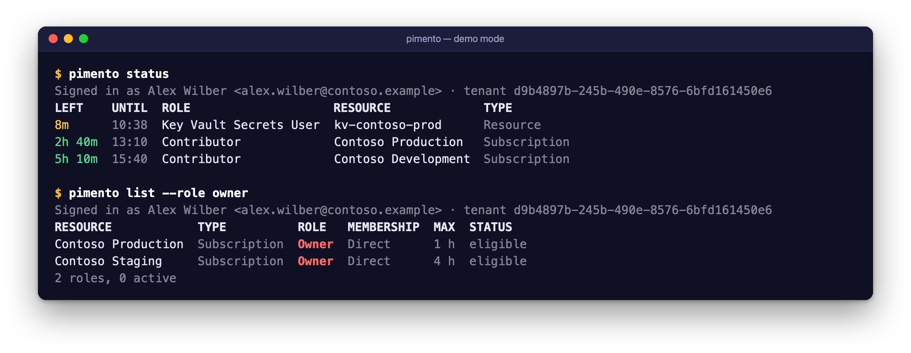


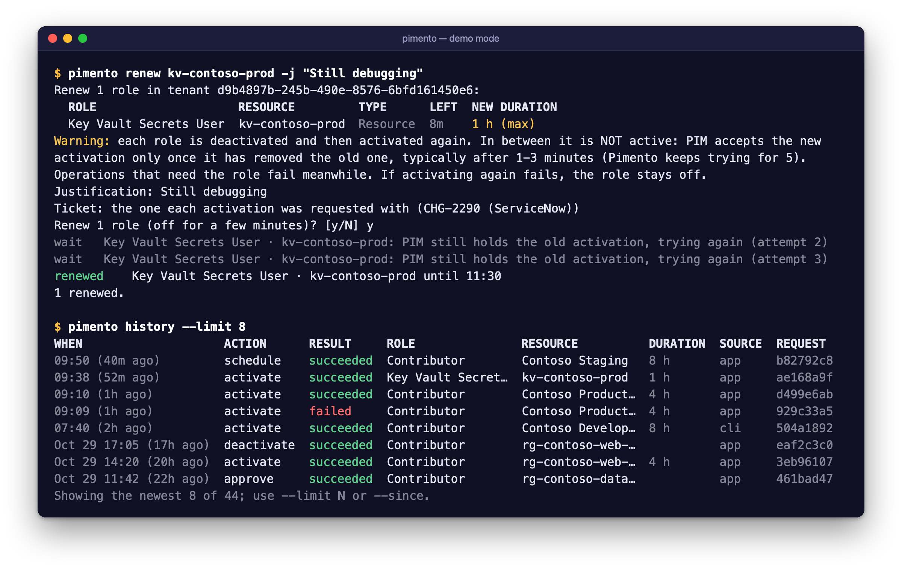

<sub>Demo mode (`pimento --demo`), synthetic data.</sub>

<!-- cli-readme:start -->
`pimento` lists and activates your PIM roles from a terminal or a script. It runs the same
code as the app, with your `az login` session or, after `pimento login`, its own sign-in (see
*Signing in* below): access tokens stay in memory and are only sent to `management.azure.com`.

```sh
pimento list                                 # eligible roles in az's current tenant, and which are active
pimento list prod --role Owner               # resource name contains "prod", role is exactly Owner
pimento list --eligible --tenant contoso.onmicrosoft.com
pimento status                               # active roles, soonest-expiring first, with time left
pimento tenants                              # tenants your az login can reach

# Activate: shows the plan, highlights Owner roles, asks [y/N]
pimento activate prod staging --role Reader -j "INC-1234 look at logs" --hours 2
# Show the exact PUT requests, send nothing
pimento activate --all -j "on-call" --dry-run
# From a script: --yes is required when stdin is not a terminal
pimento activate contoso-dev --role Contributor -j "deploy" --yes --json | jq .summary
# The longest each role's PIM policy allows
pimento activate prod --role Owner -j "INC-1234" --hours max

# Schedule for later, list what is pending, cancel it
pimento activate contoso-dev --role Contributor -j "release" --at "tomorrow 08:00"
pimento scheduled
pimento cancel 5f0c1d2e
# A role whose policy requires a ticket
pimento activate prod --role Owner -j "change" --ticket CHG-1001 --ticket-system ServiceNow

# Roles that need approval: see what waits, wait for the decision (exit 0 approved, 1 denied, 4 timeout)
pimento pending
pimento wait --all --timeout 2h && ./deploy.sh
# As an approver: list, approve or deny (asks first; --dry-run sends nothing)
pimento approvals
pimento approve 5f0c1d2e -j "matches CHG-1001"
pimento deny 7a1b -j "use the staging subscription"

# End roles early, or renew them for a fresh duration (asks first)
pimento deactivate contoso-dev --role Contributor
pimento renew contoso-dev --role Contributor -j "INC-1234 still on it" --hours 2
# Ask an administrator to extend an admin-assigned, time-bound assignment
pimento extend fabrikam --role Reader -j "project runs until March" --days 90
# Keep roles alive during working hours, until Ctrl-C (asks first; --dry-run shows the plan)
pimento keep-alive contoso-dev --role Contributor
pimento keep-alive --preset On-call --days mon-thu --window 07:00-19:00 --yes

# Presets (shared with the app)
pimento presets save On-call prod --role Owner -j "on-call" --hours max
pimento activate --preset On-call
pimento presets list

# History (shared with the app): what was sent and how it went
pimento history --since 7d
pimento history --action approve,deny --outcome failed --json
pimento history export ~/Desktop/pim-history.csv --since 2026-10-01
pimento history import-azure --since 30d     # add your requests from the portal (read-only)

# Is there a newer version? (the only command that contacts GitHub)
pimento version --check
```

| Command | What it does |
| --- | --- |
| `pimento list [FILTER…] [--role NAME] [--id ID] [--active \| --eligible]` | Table of your eligible roles, with status and expiry |
| `pimento activate (FILTER… \| --role NAME \| --id ID \| --all \| --preset NAME \| --preset-id ID) -j TEXT [--hours N\|max] [--at WHEN] [--ticket NUMBER [--ticket-system NAME]] [--yes] [--dry-run] [--max-parallel N]` | Activates the matching roles that are not active yet, in parallel (8 at a time by default), or schedules them with `--at` |
| `pimento deactivate (FILTER… \| --role NAME \| --id ID \| --all \| --preset NAME) [-j TEXT] [--yes] [--dry-run]` | Ends the matching activations now (`SelfDeactivate`) |
| `pimento renew (FILTER… \| --role NAME \| --id ID \| --all \| --preset NAME) -j TEXT [--hours N\|max] [--ticket NUMBER [--ticket-system NAME]] [--yes] [--dry-run]` | Ends and activates the matching roles again, for a fresh duration (the role is off for a few minutes in between), with the original activation's ticket or `--ticket` |
| `pimento extend (FILTER… \| --role NAME \| --all) -j TEXT [--days N] [--yes] [--dry-run]` | Asks an administrator to extend admin-assigned, time-bound assignments (`SelfExtend`) |
| `pimento keep-alive (FILTER… \| --role NAME \| --all \| --preset NAME) [--days DAYS] [--window FROM-TO] [--hours N\|max] [-j TEXT] [--yes] [--dry-run]` | Keeps the matching roles active during working hours until Ctrl-C, with the app's [keep-alive rules](#keep-alive): reads your roles at least every 10 minutes and continues each one before it ends. Continuations already scheduled still start after Ctrl-C (`pimento cancel` withdraws them) |
| `pimento scheduled` | Your scheduled activations and requests awaiting approval, from Azure |
| `pimento cancel (REQUEST-ID… \| FILTER… \| --role NAME \| --all) [--yes] [--dry-run]` | Cancels them (`POST …/cancel`) |
| `pimento pending` | Your requests waiting for approval, with when you asked and when they expire |
| `pimento wait (REQUEST-ID… \| --all) [--timeout 30m]` | Waits until they are decided (read-only, every 30 s): exit 0 approved, 1 denied/expired/cancelled/not found, 4 timeout |
| `pimento approvals` | Requests you can approve or deny as a PIM approver |
| `pimento approve REQUEST-ID… -j TEXT [--yes] [--dry-run]`, `pimento deny …` | Decides them (`PATCH …/roleAssignmentApprovals/{id}/stages/{stage}`) |
| `pimento status` | Active roles with the time left, soonest-expiring first |
| `pimento tenants` | Tenants by ID, name and domain (none: exit 0, with a note on stderr; `[]` with `--json`) |
| `pimento presets [list] \| show NAME \| save NAME FILTER… [--role NAME] [--exact] [-j TEXT] [--hours N\|max] [--ticket-system NAME] [--force] \| delete NAME` | Saved presets (see below) |
| `pimento history [WORD…] [--since WHEN] [--until WHEN] [--action NAME…] [--outcome NAME…] [--tenant ID\|NAME] [--limit N] [--json \| --csv]` | The history, newest first (50 rows in the table unless `--limit`; all with `--json`/`--csv`) |
| `pimento history export FILE.csv [filters]`, `history import-azure [--since WHEN]`, `history clear [--yes]` | CSV to a file (`-` for stdout); add your past requests from Azure (read-only); delete it (asks, or `--yes`) |
| `pimento login [--device-code] [--client-id ID] [--tenant ID]` | Signs in without the Azure CLI (browser, or a code to enter on another device) and makes Pimento sign-in the auth source |
| `pimento logout [--all]` | Forgets the signed-in account (or all); with none left, the Azure CLI is the auth source again |
| `pimento whoami` | The auth source and where it was chosen, who its token is for, and Pimento sign-in's accounts (exit 3 when not signed in) |
| `pimento mcp [--allow-activate [--allow-privileged] [--no-confirm]] [--tenant ID]` | A Model Context Protocol server on stdin/stdout for AI agents; read-only unless `--allow-activate` (see [AI agents (MCP)](#ai-agents-mcp)) |
| `pimento completions zsh\|bash\|fish\|powershell` | Prints a shell completion script |
| `pimento version [--check] [--json]` | The version; with `--check`, also the latest release on GitHub and how to update (exit 1 when the check could not be made) |
| `pimento help [COMMAND]` | Help for a command (also `COMMAND --help`) |

`list`, `activate`, `deactivate`, `renew`, `extend`, `scheduled`, `cancel`, `pending`, `wait`, `approvals`, `approve`,
`deny`, `status` and `tenants` take `-t, --tenant ID` and `--json`. The tenant is
`--tenant`, else `$PIMENTO_TENANT`, else az's current tenant (with Pimento sign-in: the tenant
you signed in to).

**Signing in.** Every command takes `--auth az|pimento`: the Azure CLI session (the default) or
Pimento's own sign-in. Without the flag, `$PIMENTO_AUTH` decides, then the choice saved by
`pimento login` or the app's Settings › Account. `pimento login` needs the client ID of your app
registration (`--client-id`, `$PIMENTO_CLIENT_ID`, or saved); see
[Pimento sign-in](#pimento-sign-in-without-the-azure-cli). On an SSH session or a machine without
a browser, use `pimento login --device-code`. Sign-in errors print a readable reason (for AADSTS
codes) and the command that fixes them.

**Demo mode.** Every command also takes `--demo` (or `PIMENTO_DEMO=1`): it then runs against a
simulated Azure with synthetic data (Contoso, Alex Wilber), offline, in a temporary folder of its own,
without touching your settings, files or tokens. `PIMENTO_DEMO_CLOCK=10:30` freezes its clock for
tidy terminal screenshots. See [Demo mode](#demo-mode).

**Updates.** No command contacts anything but Azure, except `pimento version --check`: it asks GitHub
for the latest release and prints the current and latest versions; when the latest is newer, it prints
the release page and the installer command to run again. Nothing is downloaded or installed. Exit code
0 when the check worked (newer version or not), 1 when it could not be made (offline, GitHub's rate
limit, `PIMENTO_NO_UPDATE_CHECK=1`, demo mode). See [Updates](#updates).

**Selecting roles.** A FILTER matches the resource name (case-insensitive substring); several
filters are OR-ed. A filter starting with `/` is an ARM scope and matches it and everything below
it. `--role` matches the whole role name, case-insensitively, with `*` as a wildcard:
`--role owner` is Owner only, `--role '*owner'` also matches Storage Blob Data Owner. Repeat
`--role` for several roles. `--id ID` (`list`, `activate`, `deactivate`, `renew`) selects exactly the
role whose `id` or `eligibilityScheduleId` in `list --json` is ID, for scripts and launchers that
picked one row: a scope filter would also match the roles below that scope. `activate` needs at least
one FILTER, `--role`, `--id`, `--all` or `--preset`.

**Duration.** `--hours N` (1 to 24, default 8) or `--hours max`. Before activating, `pimento` reads
each role's PIM policy (`roleManagementPolicyAssignments`) and requests at most its maximum: the
plan has a DURATION column and a note when a role was capped. When a policy cannot be read, the
asked duration is used (8 hours for `max`). `pimento list` shows the maximum in a MAX column.

**Scheduling.** `--at WHEN` schedules the activations instead of starting them now (see
[Scheduled activations](#scheduled-activations-and-tickets) for what PIM does). WHEN is read in your
local time zone unless it carries one:

| WHEN | Meaning |
| --- | --- |
| `now` | right away (the default) |
| `+90m`, `+1h`, `+1h30m`, `+2d` | from now (units `d`, `h`, `m`/`min`) |
| `08:00`, `8:30`, `8` | the next time it is that time: today if still ahead, else tomorrow |
| `today 17:00`, `tomorrow 08:00` (also `tomorrow08:00`) | that day |
| `mon 08:00` … `sunday 9:15` | the next such weekday (today if the time is still ahead) |
| `workday 08:00` | the next working day (Monday to Friday) after today |
| `2026-11-02 08:00`, `2026-11-02T08:00` | a local date and time |
| `2026-11-02T08:00:00Z`, `…+01:00`, `…-0500` | ISO 8601 with a zone |

A time in the past, more than 30 days ahead, or unreadable stops with exit code 2 before anything
is sent. A role that is active now is scheduled when its activation ends by the start, and skipped
when it is still active then. `pimento scheduled` lists pending activations (ID is the start of the
request id); `pimento cancel` takes request ids (the first 4 or more characters), resource filters,
`--role` or `--all`, shows what it will cancel and asks, like `activate`. A target of only hex digits
and dashes is always a request id: one that matches no pending request is reported as not found
(exit 1), never retried as a resource filter.

**Tickets.** `--ticket NUMBER --ticket-system NAME` sends `ticketInfo` with every request; any role
accepts it. When a role's policy requires a ticket and the number or the system is missing,
`activate` names the roles and stops with exit code 2 (checked against the policies it reads, also
in a dry run). A preset's ticket system (`presets save --ticket-system`) completes `--ticket`.

**Approvals.** A role whose policy requires approval is submitted: `activate` prints
`awaiting approval  Contributor · Contoso Staging (request 7a1b2c3d)`, a note that nothing is active
until an approver decides, and exits 0. `pimento pending` lists such requests (ASKED, EXPIRES:
approvers have 24 hours). `pimento wait ID…` (ids or their first 4+ characters, also already decided
ones) or `--all` reads your requests every 30 seconds until each is decided, printing *approved* with
the end of the activation, *denied* with the approver's justification when Azure shows it,
*expired* or *cancelled*. `--timeout` takes `30m` (default), `2h`, `1h30m`, `90s` or minutes, up to 24h.
Exit codes: 0 all approved, 1 any denied, expired, cancelled, failed or not found, 4 timed out.

`pimento approvals` lists the requests you can decide (an empty list, exit 0, when you have none or
no approver permissions). `pimento approve ID… -j TEXT` and `pimento deny ID… -j TEXT` follow the
safety rules below: the requests first (Owner, User Access Administrator and Role Based Access
Control Administrator marked `(!)` with a warning for approve, since they can grant anyone access), a `[y/N]` prompt on a
terminal, `--yes` otherwise, `--dry-run` prints the `PATCH` and its body and sends nothing. A
request decided by someone else meanwhile is reported as not pending (exit 1). The ID column shows
the whole request id: on a terminal its first 4+ characters are enough (the prompt shows the
request it matched), but `--yes` takes only whole ids, matched exactly, so a request submitted
later under the same prefix is never decided unseen.

**Ending and renewing.** `deactivate`, `renew` and `extend` follow the same safety rules as
`activate`: an explicit selection, the plan first, a `[y/N]` prompt on a terminal, `--yes` required
otherwise, and `--dry-run` sends nothing. `deactivate` and `renew` only consider active roles;
a role activated less than 5 minutes ago is reported as *too soon* with the time from which it
can be ended (exit code 1). `renew` warns that the role is off between the two requests, retries
the activation for up to 5 minutes while PIM removes the old one, and skips roles whose policy
requires approval or cannot be read. It sends the ticket the current activation was requested with, or `--ticket`
(with `--ticket-system`, or the preset's); a role whose policy requires a ticket is skipped when
neither is known. `extend` leaves PIM activations out (use `renew`) and asks for the end of each
matching admin-assigned assignment to move `--days` later (default 30); an administrator decides.
See [Ending and renewing](#ending-and-renewing-activations).

**Presets.** `pimento activate --preset NAME` activates the roles of a preset saved in the app or
with `pimento presets save`. The preset's justification and duration apply unless you pass `-j` or
`--hours`. Roles you are no longer eligible for are listed as *missing* and left out; the rest is
activated (exit code 1 only when none is left). A preset belongs to a tenant: without `--tenant`,
a preset name that exists in one tenant only uses that tenant. With a tenant, the preset of that
tenant (by GUID, or by the domain you passed) wins over a preset for any tenant of the same name.
`--preset-id ID` (`activate`) picks exactly the preset whose `id` in `presets list --json` is ID and
runs it in its own tenant (another `--tenant` is an error): for scripts and launchers, which cannot
tell which of two same-named presets a name would pick.

`pimento presets save NAME FILTER… [--role NAME]` stores the filters as a *rule*, resolved each
time you activate, so new eligibilities that match are included; with `--exact` it stores the roles
that match now. It reads your roles (read-only) to find the tenant and shows what matches.
`--force` replaces a preset of the same name. `presets list`, `show` and `delete` work offline.

##### Preset file

The app and the CLI share `~/Library/Application Support/Pimento/presets.json`. Set
`PIMENTO_PRESETS` to use another file (for the CLI, or the app started from a terminal). It is
written atomically, readable only by you, and contains no secrets:

```json
{
  "version": 1,
  "presets": [
    {
      "id": "6f9619ff-8b86-d011-b42d-00c04fc964ff",
      "name": "On-call",
      "tenantId": "11111111-2222-4333-8444-555555555555",
      "roles": [
        {
          "scope": "/subscriptions/aaaaaaaa-0000-0000-0000-00000000000a",
          "roleDefinitionId": "/subscriptions/aaaaaaaa-0000-0000-0000-00000000000a/providers/Microsoft.Authorization/roleDefinitions/8e3af657-a8ff-443c-a75c-2fe8c4bcb635",
          "roleName": "Owner",
          "scopeName": "Contoso Production"
        }
      ],
      "match": [{ "filters": ["prod"], "roles": ["Owner"] }],
      "justification": "on-call",
      "duration": "max",
      "createdAt": "2026-10-29T12:00:00Z",
      "updatedAt": "2026-10-29T12:00:00Z"
    }
  ]
}
```

`roles` are matched by scope and role definition GUID, case-insensitively; the names are only for
display. `match` holds rules (`filters` and `roles` as on the command line). `duration` is `max` or
whole hours (`PT4H`); an optional `ticketSystem` completes `activate --ticket`; `"keepAlive": true` keeps the preset's
roles alive in the app ([Keep alive](#keep-alive); written only when on); `tenantId` may be left out for a preset that applies to every tenant. Unknown
keys are ignored. A file with a higher `version` is refused rather than overwritten.

**Safety.** `activate` lists what it will send, marks Owner roles, and asks for confirmation on a
terminal. When stdin is not a terminal it refuses unless you pass `--yes`. Roles that are already
active are skipped, not sent again. `--dry-run` uses a transport that refuses anything but `GET`.

**Output.** Tables have aligned columns. On a terminal they are fitted to the window and coloured
(unless `NO_COLOR` is set) and show who you are signed in as and a total; piped, they are plain
columns for `grep` and `awk`. Prompts, notes and errors go to stderr. With `--json`, stdout gets
exactly one JSON document (the plan and progress of `activate` go to stderr):

| Command | JSON |
| --- | --- |
| `list`, `status` | `{tenantId, user: {objectId, name, upn}, roles: [{id, roleName, roleDefinitionId, scope, scopeName, scopeType, membership, group, isOwner, grantsAccess, hasCondition, isActive, activeUntil, eligibilityScheduleId, secondsLeft, maxDuration, policy}]}` (`membership` is `direct` or `group`; `grantsAccess` marks Owner, User Access Administrator and Role Based Access Control Administrator; `secondsLeft` only in `status`; `maxDuration` (ISO 8601, e.g. `PT8H`) and `policy: {status, maxDuration, requiresJustification, requiresTicket, requiresMfa, requiresApproval, authenticationContext, error}` only in `list`) |
| `tenants` | `{tenants: [{id, displayName, defaultDomain, category}]}` |
| `activate` | `{dryRun, tenantId, user, hours, duration, preset, justification, start, ticket: {ticketNumber, ticketSystem}, results: [{outcome, role, status, start, until, code, message, rules, request, requestId, duration, maxDuration, capped}], missing: [{scope, roleDefinitionId, roleName, scopeName}], summary: {activated, submitted, scheduled, skipped, failed, planned}}` (`outcome` is `activated`, `submitted` (pending approval), `scheduled` (`--at`), `skipped`, `failed` or `planned`; `start` and `summary.scheduled` only with `--at`; `request` only in a dry run; `requestId` only for `submitted` results (for `pimento wait`); `duration` at the top is `max` or the asked ISO duration, `hours` only for a number; per result, `duration` is what was requested for that role) |
| `scheduled` | `{tenantId, user, requests: [{id, name, kind, status, start, end, duration, roleName, roleDefinitionId, scope, scopeName, scopeType, justification, ticketNumber, ticketSystem, createdOn}]}` (`kind` is `scheduled` or `awaitingApproval`; `name` is the request id) |
| `cancel` | `{dryRun, tenantId, user, results: [{outcome, request, code, message, url}], notFound, summary: {cancelled, failed, planned}}` (`outcome` is `cancelled`, `failed` or `planned`; `url` only in a dry run) |
| `pending` | as `scheduled`, only requests waiting for approval; each has `expiresAt` (also in `scheduled`) |
| `wait` | `{tenantId, user, timeout, results: [{target, outcome, status, request, until, reviewer, reviewJustification}], summary: {approved, rejected, timedOut, notFound}}` (`outcome` is `approved`, `denied`, `expired`, `canceled`, `failed`, `timeout` or `notFound`) |
| `approvals` | `{tenantId, user, available, note, requests: [{id, name, approvalId, stageId, requester: {objectId, name, email}, roleName, roleDefinitionId, scope, scopeName, scopeType, isOwner, status, start, end, duration, justification, ticketNumber, ticketSystem, createdOn, expiresAt}]}` (`available: false` with a `note` when Azure refused the listing) |
| `approve`, `deny` | `{decision, dryRun, tenantId, user, justification, results: [{outcome, request, code, message, url, body}], notFound, summary: {decided, skipped, failed, planned}}` (`outcome` is `approved`, `denied`, `planned`, `skipped` or `failed`; `url` and `body` only in a dry run) |
| `login` | `{account: {id, objectId, username, name, tenantId, homeTenantId, clientId, signedInAt, isDefault}, source, store}` |
| `logout` | `{removed: [accountId], remaining}` |
| `whoami` | `{source, origin, user, tenantId, error, accounts: [account], clientId, tokenStore}` (`origin` is `commandLine`, `environment`, `saved` or `default`) |
| `presets list`, `presets show` | `{file, presets: [{id, name, tenantId, roles, match, justification, duration, ticketSystem, createdAt, updatedAt}]}`; `show` prints one preset |
| `version` | `{version}`; with `--check`: `{version, checked, latest, publishedAt, updateAvailable, releasePage, diskImage, installCommand, error}` (`releasePage`, `diskImage` and `installCommand` only when a newer version exists; `checked: false` with `error` when the check could not be made) |

Times are ISO 8601 in UTC. Keys without a value are left out.

**Exit codes.**

| Code | Meaning |
| --- | --- |
| 0 | Success, including "nothing to do" (everything already active) and no tenants for `pimento tenants` |
| 1 | An activation or request failed, no role matched (or none of a preset's roles is eligible), you answered no, or `version --check` could not check |
| 2 | Usage error: unknown option, no justification or selection, invalid tenant or `--at` time, a required ticket missing, or a command that changes roles without `--yes` when stdin is not a terminal |
| 3 | az is missing or not signed in, Pimento sign-in has no (valid) account, or ARM rejected the token (run the `az login` or `pimento login` command it prints) |
| 4 | `pimento wait`: still no decision when `--timeout` ran out |

#### Shell completions

```sh
# zsh: any folder on $fpath, then restart the shell
pimento completions zsh > "${fpath[1]}/_pimento"
# bash (with bash-completion)
pimento completions bash > ~/.local/share/bash-completion/completions/pimento
# fish
pimento completions fish > ~/.config/fish/completions/pimento.fish
```

```powershell
# PowerShell (Windows PowerShell 5.1 and PowerShell 7, on any system): add this line to $PROFILE.
# On Windows, install.ps1 sets this up for you.
pimento completions powershell | Out-String | Invoke-Expression
```

The PowerShell completion also offers the names of your presets (after `--preset`, and after
`presets show` and `presets delete`): it reads them with `pimento presets list --json`, which
works offline. cmd.exe has no programmable completion, so there is none for it.

**Deprecated flags.** The flags of Pimento's first builds, `pimento --list`, `--dry-run` and
`--tenants`, still work in 0.1.x (also on the app binary, which hands them to the bundled CLI).
They print a note and go away in a later release. `--dry-run` keeps its old meaning: `--role` matches a substring, and
without filters it plans every eligible role.

#### Linux and Windows

The CLI works the same on Linux and Windows, with these differences:

| | macOS | Linux | Windows |
| --- | --- | --- | --- |
| Files (presets, history, `auth.json`) | `~/Library/Application Support/Pimento` | `$XDG_CONFIG_HOME/pimento`, else `~/.config/pimento` | `%APPDATA%\Pimento` |
| Refresh token (`pimento login`) | Keychain (`PIMENTO_TOKEN_STORE=file`: `~/.config/pimento/tokens.json`) | `tokens.json` in the folder above | `tokens.json` in the folder above |
| File permissions | mode 600 (folder 700 for the token file) | mode 600 (folder 700) | none of its own: your profile's permissions |
| Browser sign-in | yes (LaunchServices) | yes (`xdg-open` on a private redirect page in the temporary folder, removed afterwards; a sandboxed browser that cannot read it shows an error: open the URL the CLI prints, or use `--device-code`) | yes (the same redirect page in `%TEMP%`, opened with `ShellExecuteW`, so in the browser that opens `.html` files; the listener uses Winsock, with the port held exclusively) |
| `az` | Homebrew paths, then `PATH` | `PATH` | `az.cmd` from `PATH` (the installer's Python is run directly, never through `cmd.exe` with your arguments) |
| Colours | terminals | terminals | consoles with ANSI support (Windows Terminal, Windows 10+); `NO_COLOR` turns them off |
| Completions | zsh, bash, fish | zsh, bash, fish | PowerShell (5.1 and 7; `install.ps1` adds it to your profile); none for cmd.exe, which has no programmable completion |

`PIMENTO_PRESETS`, `PIMENTO_HISTORY`, `PIMENTO_TOKEN_FILE` and the other variables work everywhere.
The history lock on Windows is `LockFileEx` on `history.jsonl.lock`, so several `pimento` processes can
append at the same time there too.
<!-- cli-readme:end -->

### AI agents (MCP)

`pimento mcp` is a [Model Context Protocol](https://modelcontextprotocol.io) server: AI agents such as
Claude Code, Claude Desktop and Cursor can ask it which roles you have, which are active and until
when, and what each role's policy requires. With `--allow-activate` they can also activate,
deactivate and renew roles, and you confirm each request in the client before anything is sent. It
uses the CLI's sign-in (your `az login` or `pimento login`), presets and history, and runs as you.

**Setup.** The client starts the server; register it once.

```sh
# Claude Code: read-only
claude mcp add pimento -- pimento mcp
# Claude Code: may also activate, deactivate and renew (you confirm each request)
claude mcp add pimento -- pimento mcp --allow-activate
# Try it without Azure: the offline Contoso demo
claude mcp add pimento-demo -- pimento mcp --demo --allow-activate
```

Claude Desktop (*Settings › Developer › Edit Config*, `claude_desktop_config.json`) and Cursor
(`~/.cursor/mcp.json`, or `.cursor/mcp.json` in a project) take the same JSON:

```json
{
  "mcpServers": {
    "pimento": {
      "command": "pimento",
      "args": ["mcp", "--allow-activate"]
    }
  }
}
```

Leave out `--allow-activate` for a read-only server. Desktop apps often do not see your shell's
`PATH`: if the server does not start, put the full path that `command -v pimento` (Windows:
`where pimento`) prints in `command`. Add `--tenant contoso.onmicrosoft.com` (or set
`PIMENTO_MCP_TENANT`) to keep the agent in one tenant, and `--demo` to try it on the demo data.

**Tools.**

| Tool | What it does |
| --- | --- |
| `list_tenants` | Tenants your sign-in can reach (with `--tenant`, only that one) |
| `list_eligible_roles` | Your eligible roles (filter by resource, role, active/eligible), whether each is active and until when, and its policy: maximum duration, approval, ticket, justification, MFA; `highPrivilege` marks Owner and the access administrator roles |
| `list_active_roles` | Active roles, soonest-expiring first, with the minutes left |
| `list_presets` | Your saved presets |
| `list_pending_approvals` | Your requests waiting for an approver |
| `get_history` | What Pimento sent and how it went (filters as `pimento history`; with `--tenant`, only that tenant's records) |
| `activate_roles` | *With `--allow-activate`.* Activates roles named by exact role and scope (or a preset), with a justification, `hours` (capped at each policy's maximum) and a ticket where the policy needs one |
| `deactivate_roles` | *With `--allow-activate`.* Ends active roles |
| `renew_roles` | *With `--allow-activate`.* Ends and activates roles again for a fresh duration (roles that need approval are not renewed) |

Results are JSON (`structuredContent`, and the same as text). The read tools are marked
`readOnlyHint`, `deactivate_roles` and `renew_roles` `destructiveHint`.

**A read-only example.** *"Which of my PIM roles run out in the next hour?"* The agent calls
`list_active_roles` and answers from `minutesLeft`. *"Can I activate Contributor on Contoso
Production for 8 hours?"* It calls `list_eligible_roles` with `"role": "Contributor"` and reads
the policy: maximum 4 hours, a ticket required.

**An activation example.** *"Give me Reader on Contoso Production for the INC-1234 log
investigation."* The agent calls

```json
{"name": "activate_roles", "arguments": {"roles": [{"role": "Reader", "scope": "Contoso Production"}],
 "justification": "INC-1234 log investigation", "hours": 8}}
```

and your client shows Pimento's confirmation, with a checkbox you have to tick:

```text
An AI agent asks Pimento to ACTIVATE this Azure role for alex@example.com in tenant …:

1. Reader on "Contoso Production" (Subscription) for 8 h
   /subscriptions/00000000-0000-0000-0000-000000000000

Justification (from the agent): "INC-1234 log investigation"

Only confirm if you asked for this. Nothing is sent unless you check the box and accept.
```

Only after you accept does Pimento send the `PUT`; the result (*activated until 18:42*, *awaiting
approval*, the failed policy rule, …) goes back to the agent and into the history.

**Safety model.**

- **Read-only by default.** Without `--allow-activate` the write tools are not listed, a call to
  them is refused, and every request the server makes goes through the GET-only transport the
  CLI's read-only commands use.
- **You confirm every write.** With `--allow-activate`, each activation, deactivation and renewal
  is planned first (read-only), shown to you through MCP *elicitation* (a form in the client: the
  roles, their scopes by name and full ARM path, durations, the agent's justification and ticket, warnings, and which roles
  a keep-alive preset will renew beyond that duration), and sent only when you
  accept with the box ticked. Declining, dismissing, an unticked box, no answer within 10 minutes,
  or the end of the session sends nothing. Before sending, Pimento plans again from fresh data and
  sends only if the plan is still exactly what you confirmed (also for the same signed-in account). On the stateless protocol revision the
  confirmation is a random, single-use handle that expires after 10 minutes and is bound to the tool
  and its exact arguments; a client cannot forge or replay it.
- **Clients that cannot ask you.** If the client does not support elicitation, the server refuses to
  write and says why (on the 2026-07-28 revision as `MissingRequiredClientCapability`). Writing
  anyway needs `--no-confirm`, which you choose for that client: the client's own tool approval
  (Claude Code and Cursor ask before running a tool unless you allowed it permanently) is then the
  only confirmation. A client that can ask is always asked, `--no-confirm` or not. (Pimento does
  not ask in a terminal or a window of its own: a server started by the client has no terminal,
  and on Linux, Windows or over SSH there may be no screen to show a window on.)
- **High-privilege roles need a second opt-in.** Activating or renewing Owner, User Access
  Administrator or Role Based Access Control Administrator (roles that can grant anyone access; the
  CLI marks them `(!)`) is refused unless the server runs with `--allow-privileged`, and then the
  confirmation has a second box for them. Deactivating them needs no extra flag.
- **Policy limits.** Every duration is capped at the role's policy maximum (1 to 24 hours asked); a
  role whose policy cannot be read is not activated. A justification is required (1 to 500
  characters), and a ticket number and system wherever the policy requires a ticket.
- **Strict inputs.** Tool arguments are treated as untrusted: unknown keys, wrong types, empty or
  overlong values (in characters, and in Unicode scalars at four per character), and control, bidi
  and invisible characters (every default-ignorable code point, such as the variation selectors
  that could hide text in a justification; only an emoji's own presentation selector is kept, as in
  ⚠️ or 1️⃣) are refused, in every string argument; roles are named
  by exact role name and scope (no wildcards), a name that fits several scopes is refused, at most
  20 roles per call, and the tenant must be a GUID or domain (and the `--tenant` one, if set).
  Nothing an agent passes is run by a shell or used as a file name.
- **History.** Every write is recorded in Pimento's history like the CLI's, with the source `mcp`.
- **Nothing secret in results.** Tool results never contain tokens, the sign-in state, or file
  paths; error messages are filtered for paths and anything token-like. Reads and writes are rate
  limited, writes run one at a time, and logs go to stderr only.

**Threat model.** The agent is not trusted: text it reads (a web page, an issue, a file) can tell it
to grant itself access, so Pimento treats every tool argument as hostile and puts a human decision
between the agent and every write. The trust boundary is the MCP client and its configuration: the
client shows the confirmation, so a compromised client, or an agent that can edit the client's MCP
configuration (adding `--no-confirm --allow-privileged`) or run `pimento activate --yes` in a shell,
is outside what the server can defend against; keep agents that have shell or file access away
from those. The confirmation shows the agent's justification and ticket as quoted text: read the
roles, not just the reason. Pimento itself acts only as you, with your own sign-in and Azure's own
checks (PIM policies, approvals, MFA), so an agent can never get more than you could activate
yourself.

**Protocol.** `pimento mcp` speaks MCP over stdio, one JSON-RPC message per line, Foundation only. It
is *dual-era*: requests with `_meta["io.modelcontextprotocol/protocolVersion"]` are served
statelessly under the current revision, **2026-07-28** (`server/discover`, confirmation through
multi round-trip requests), and an `initialize` handshake selects 2025-11-25, 2025-06-18, 2025-03-26
or 2024-11-05 (the newest of them for an unknown version; elicitation from 2025-06-18 on, as a
server-to-client `elicitation/create` request). It has tools only (no resources or prompts).

## Integrations

Pimento also works from **Raycast** and **Alfred**. Both are thin launchers: they run the installed
`pimento` CLI with `--json`, so they need it [installed](#install-the-command-line-tool) and signed in
(`az login` or `pimento login`). They never talk to Azure or see a token. They look for it in
`~/.local/bin`, then `PATH` and the Homebrew folders, then inside `/Applications/Pimento.app`, or
where their settings say; like the CLI with `az`, they skip a `pimento` whose file or folder another
user could change. Each has a demo mode setting (`pimento --demo`) to try it with synthetic
data. Neither is in a store; install them from this repository.

**Raycast** ([`integrations/raycast`](integrations/raycast/README.md)): *Search PIM Roles*
(activate with a justification and duration, or deactivate), *Activate PIM Preset* and *Active PIM
Roles* (with the time left). Needs Node.js 22.22 or later to install:

```sh
cd integrations/raycast
npm ci
npm run dev        # imports it into Raycast; stop with Ctrl-C, the extension stays
```

**Alfred** ([`integrations/alfred`](integrations/alfred/README.md), Alfred 5 with the Powerpack):
the `pim` keyword lists presets and roles. ↩ on a role, then `>` and a justification, activates it;
↩ on a preset activates it; ⌥↩ on an active role deactivates it. It uses only `/bin/sh` and
JavaScript for Automation:

```sh
integrations/alfred/build.sh       # build/Pimento.alfredworkflow; open it to import into Alfred
```

Both pick a single role with `pimento activate --id` / `deactivate --id`, the `id` from
`pimento list --json`, and a preset with `pimento activate --preset-id`, the `id` from
`pimento presets list --json`, which scripts can use as well.

## How it works

Pimento calls [Azure Resource Manager](https://learn.microsoft.com/rest/api/authorization/privileged-role-assignment-rest-sample)
directly with the PIM APIs (`api-version=2020-10-01`):

1. **Token.** It runs `az account get-access-token --resource https://management.azure.com/`
   (plus `--tenant` when one is selected). The same token lists your tenants
   (`GET /tenants?api-version=2022-12-01`) for the tenant picker. `az` is looked up once per process
   at `/opt/homebrew/bin/az`, `/usr/local/bin/az`, then in the absolute folders of `$PATH` (never
   the current directory), and only a file that root or you own and nobody else can change (nor its
   folder) is used. It runs from an argv array, never a shell, with a `PATH` without relative
   entries; its output is capped at 16 MB, and cancelling ends it. Your object ID comes from the
   token's `oid` claim.
2. **List eligible.**
   `GET /providers/Microsoft.Authorization/roleEligibilityScheduleInstances?$filter=asTarget()`
   at tenant level. `asTarget()` returns everything you are eligible for, **including
   eligibilities inherited through group membership**. `nextLink` pages are followed (only
   when they point back to `management.azure.com`).
3. **List active.** The same call for `roleAssignmentScheduleInstances`. An eligibility counts as
   active when an `Activated`, not-yet-expired instance exists for the same scope and role
   definition.
4. **Policy.** For each role, `GET {scope}/providers/Microsoft.Authorization/roleManagementPolicyAssignments?$filter=roleDefinitionId eq '…'`
   (a few at a time, cached for the session). Of its `effectiveRules`, Pimento reads the end-user
   activation rules: `Expiration_EndUser_Assignment.maximumDuration` (the longest activation),
   which of justification, ticket and MFA `Enablement_EndUser_Assignment` requires, whether
   `Approval_EndUser_Assignment` needs approval, and the authentication context.
5. **Activate.** For each selected role:
   `PUT {scope}/providers/Microsoft.Authorization/roleAssignmentScheduleRequests/{new-guid}`
   with `requestType: SelfActivate`, `principalId` = you (also for group-inherited roles),
   `linkedRoleEligibilityScheduleId`, the justification and
   `scheduleInfo.expiration = {type: AfterDuration, duration: PT<n>H}` (at most the role's
   maximum, so it can also be `PT1H30M`). If the eligibility
   carries an ABAC `condition`, it is copied verbatim together with `conditionVersion`;
   without it, ARM rejects the request.
6. **Results.** `RoleAssignmentExists` becomes *Skipped (already active)*;
   `RoleAssignmentRequestPolicyValidationFailed` lists the failing rules; token errors point
   to `az login`.
7. **Deactivate.** The same `PUT` with `requestType: SelfDeactivate`, `principalId`, the role
   definition, `linkedRoleEligibilityScheduleId` and the eligibility's `condition` (if any), and no
   `scheduleInfo`. In an activation's first 5 minutes PIM answers `RoleAssignmentDoesNotExist`
   (Microsoft's docs also name `ActiveDurationTooShort`); both become *Too soon*.
   `RoleAssignmentDoesNotExist` later on means the activation had already ended.
8. **Renew** = 7, then 5 with a new request id and start time. Until PIM has removed the old
   assignment it answers `RoleAssignmentExists`; Pimento retries for about 5 minutes.
9. **Extend** (`pimento extend`): `requestType: SelfExtend` with `targetRoleAssignmentScheduleId`
   and `scheduleInfo.expiration = {type: AfterDateTime, endDateTime: <end + days>}`. PIM answers
   `201` with status `PendingAdminDecision`.
10. **Your requests** (Scheduled, `pending`, `wait`, Renew's ticket):
   `GET /providers/Microsoft.Authorization/roleAssignmentScheduleRequests?$filter=asTarget()` lists
   pending and past requests. A request waiting for approval has status `PendingApproval` and an
   `approvalId`; once decided it becomes `Provisioned`/`Granted`, `Denied`, `TimedOut` (after 24
   hours) or `Canceled`. A request's name is the last segment of the `targetRoleAssignmentScheduleId`
   it creates, which is how Renew finds the ticket an active role was requested with.
10b. **Keep alive**: 15 minutes before a kept role ends, the `PUT` of step 5 with
   `scheduleInfo.startDateTime` = the current activation's `endDateTime` (a scheduled activation,
   status `Granted`), the justification and ticket of the request behind the current activation
   (step 10) and a duration clipped to the working hours. A role that lapsed is activated with the
   plain `PUT` of step 5; a continuation of a role ended early is withdrawn with `POST …/cancel`.
11. **History import**: the same `asTarget()` listing as 10, mapped to history entries (your
   `SelfActivate`, `SelfDeactivate`, `SelfExtend` and `SelfRenew` requests; a `SelfActivate`
   starting more than a minute after it was made counts as scheduled) and merged by request name.
12. **Approvals** (approver side; the `roleAssignmentApprovals` API is a **preview**,
   `api-version=2021-01-01-preview`): `GET …/roleAssignmentScheduleRequests?$filter=asApprover()`
   (2020-10-01) lists the requests you may decide, with requester, role, schedule, justification and
   ticket; `GET /providers/Microsoft.Authorization/roleAssignmentApprovals?$filter=asApprover()`
   their stages (`asApprover()` is the only filter it accepts at the tenant root; anything else is a
   400). A decision is
   `PATCH /providers/Microsoft.Authorization/roleAssignmentApprovals/{approvalId}/stages/{stageId}`
   with `{"reviewResult": "Approve" | "Deny", "justification": "…"}` on the stage that is
   `InProgress` and `assignedToMe` (read from `…/stages` when the listing does not name it). A 400,
   403 or 404 listing means no approvals to show. Microsoft documents that ARM cannot approve
   extend and renew requests.

## Security and privacy

- Pimento acts **as you**, with your own `az` session or, with
  [Pimento sign-in](#pimento-sign-in-without-the-azure-cli), a delegated token of *your* app
  registration (a public client: no secret, no certificate, no application permissions). It has no
  service principal or elevated permission of its own, and can do nothing you could not do in the portal.
- Access tokens are fetched on demand, **kept in memory only**, and sent **only to
  `management.azure.com`**. They are never written to disk, logged or displayed.
- Pimento sign-in sends authorization codes, PKCE verifiers, device codes and refresh tokens **only
  to `login.microsoftonline.com`** (its token and device-code endpoints, over HTTPS; a guard refuses
  any other host or method). The browser redirect is received on 127.0.0.1/::1 only (on Windows
  with the port held exclusively, so no other program can bind it), checked against a random
  `state`, and the listener stops after one answer or 5 minutes. The **refresh token** is
  kept in the macOS **Keychain** (or, on Linux or with `PIMENTO_TOKEN_STORE=file`, in
  `~/.config/pimento/tokens.json`, mode 600; on Windows in `%APPDATA%\Pimento\tokens.json`: less secure). `pimento logout` / *Sign Out* delete it.
  `auth.json` holds the auth source, client ID, chosen account and a pending claims challenge, no secrets.
- It keeps its settings in `UserDefaults`: the chosen tenant ID, the hidden tenant IDs, table
  columns, the options from the Settings window and, unless you turn it off, your last
  10 justifications (Settings › Activation clears them).
- The only write calls are the `roleAssignmentScheduleRequests` `PUT`s (activate, deactivate,
  renew, extend), `POST …/cancel`, and the approval `PATCH` (approve, deny). They run after you
  confirm in the app (Activate asks for Owner roles, Approve for Owner and the access administrator roles; Deactivate, Renew, Cancel and
  Deny always ask), after a tap on *Renew* / *End Now* in a reminder, or when the CLI command has
  your confirmation (or `--yes`). *Keep alive* is a standing instruction: marking a role (or
  preset) is the consent for its renewals during working hours, until you turn it off or pause it;
  `pimento keep-alive` asks once when it starts. Following your requests for a decision is read-only (`GET`).
  **Preview** in the app and `pimento activate --dry-run` show the requests without sending them.
- Presets are kept in `~/Library/Application Support/Pimento/presets.json` (mode 600): names,
  ARM scopes and role definition IDs, and the justification and duration you chose to save.
- The **history** (`~/Library/Application Support/Pimento/history.jsonl`, mode 600) records what the
  app and the CLI sent: time, tenant, role, resource, outcome, duration, justification, ticket and
  request ID. No tokens, no request or response bodies; error messages are cut to one short line,
  and one that looks like a raw body is not kept. Turn it off or shorten the retention under
  Settings › History; *Clear History…* or `pimento history clear` deletes it. The CSV export is
  written with mode 600 too.
- The `pimento` CLI keeps no other state: no settings of its own beyond `auth.json`, no access-token
  cache. It writes the presets file (`pimento presets save` and `delete`), the history, and with
  `pimento login` / `logout` the refresh token and `auth.json`.
- **`pimento mcp`** (for AI agents) is read-only unless started with `--allow-activate`; then
  every write is confirmed by you in the MCP client first, high-privilege roles need
  `--allow-privileged` as well, and tool results never contain tokens or file paths. See
  [AI agents (MCP)](#ai-agents-mcp).
- **Update check.** The app (once a day, unless turned off in *Settings › General*) and
  `pimento version --check` (only when you run it) send one HTTPS `GET` to
  `https://api.github.com/repos/Melvin2306/pimento/releases/latest`, with a 10-second timeout and a
  20-second limit for the whole check. The request carries no token, cookie, account, tenant, device
  or installation ID: only `User-Agent: Pimento/<version>` (GitHub requires one), the API's
  `Accept` and version headers, and a fixed `Accept-Language: en` (not your system's languages). GitHub sees your IP address, as with any request. It goes through the
  same private session as the logo fetch (no cookies, cache or stored credentials; every
  authentication request but the server's certificate check refused, so no client certificate or
  password is offered). Redirects are refused, and a guard refuses any other URL or method. The answer is treated as untrusted: the tag must be a strict
  semantic version, drafts and pre-releases are ignored, answers over 1 MB are refused, and the links
  Pimento opens (release page, disk image) are built from that version and must lie under
  `https://github.com/Melvin2306/pimento/`; no URL is taken from the answer. Nothing is downloaded or
  installed; *Download* opens your browser. The app keeps the time and result of the last check (and the version whose notice you closed) in its
  `UserDefaults`. `PIMENTO_NO_UPDATE_CHECK=1` turns the check off in the app and the CLI; demo mode
  never checks. No other command of the CLI reaches anything but Azure.
- **Tenant logos** are off by default: tenants show initials drawn on the Mac. With *Settings ›
  General › Fetch tenant logos* on, for each tenant the app shows (the current one and those in
  the picker, not hidden ones) it sends, without a token, account or cookie (and refusing any
  website that asks for a password or certificate), with the `User-Agent` `Pimento/<version>` and a
  fixed `Accept-Language: en` (not your system's languages):
  1. `POST https://login.microsoftonline.com/common/GetCredentialType` with
     `{"username":"pimento-logo-lookup@<the tenant's .onmicrosoft.com or other verified domain>"}`
     (no such user exists; it is how the sign-in page finds a tenant's branding), then a `GET` of
     the square logo it names, only from Microsoft's branding CDNs (`aadcdn.msftauthimages.net`,
     `aadcdn.msauthimages.net`, `secure.aadcdn.microsoftonline-p.com`);
  2. without one, `GET https://<the tenant's first verified domain that is not Microsoft's>/apple-touch-icon.png`,
     then `/favicon.ico` (redirects followed only within that domain, over HTTPS).

  So **Microsoft and each tenant's own website learn that this Mac looked them up** (your IP
  address and the domain). The lookup is not a sign-in attempt, so it is not expected in the
  tenant's sign-in logs, but Microsoft does not document what it records about it. HTTPS only,
  10-second request timeouts, at most 512 KB per answer, and only files that decode as an image of
  32 to 1024 pixels are kept: in `~/Library/Application Support/Pimento/TenantLogos` (mode 600) for
  7 days, a tenant without a logo included. *Refresh Logos* fetches again, *Clear Cache* deletes
  them, and turning the setting off deletes them too and stops the fetches under way. Never in demo
  mode, never by the CLI.
- No analytics, no telemetry, no third-party dependencies (the CLI's argument parser is
  hand-written, so the build needs no package downloads).

See [SECURITY.md](SECURITY.md) for how to report a vulnerability.

## Limitations

- **Azure resource roles only** (management groups, subscriptions, resource groups, resources).
  **Microsoft Entra roles** (Global Administrator, ...) and **PIM for Groups** are managed through
  Microsoft Graph and need Graph permissions such as `RoleManagement.ReadWrite.Directory` /
  `PrivilegedAccess.ReadWrite.AzureADGroup`, which the Azure CLI's first-party app cannot obtain.
- **Approval-required roles** are submitted and shown as *Awaiting approval* until an approver
  acts; they are not renewed (the role would be off until someone approves). Approving and denying
  uses ARM's **preview** approvals API; it was not exercised against a live approval while writing
  Pimento (see the changelog), and Microsoft documents that ARM cannot approve extend or renew requests.
- **The approver's reason** on a denied request is shown only when Azure lets the requester read the
  approval's stages.
- **New approval requests** are noticed when Pimento refreshes (and while your own requests wait);
  with auto-refresh off, that is at launch and on Refresh.
- **No self-service extension of an activation.** PIM does not offer one; *Renew* starts a new
  activation and leaves a gap of a few minutes. *Keep alive* avoids the gap by scheduling the next
  activation for the moment the current one ends; that hand-over was built from Microsoft's
  documentation and tested against the demo simulator, not yet against a live tenant. When it does
  not work, the role is activated again after it ended (a gap of seconds to minutes). Extension requests for admin-assigned time-bound
  assignments are CLI-only (`pimento extend`), and the app does not list those assignments.
- **Keep alive** works only while Pimento (or `pimento keep-alive`) runs: a continuation already
  scheduled still starts without it, but nothing further is renewed, and a role that lapsed meanwhile
  is activated again only when Pimento looks next (inside working hours). Roles whose policy requires
  approval, MFA or an authentication context the token lacks are not kept alive (the first are
  skipped, the others fail and back off). The marks are per tenant and account on this Mac; the CLI does not read
  them (it takes a selection or a preset).
- **Reminder actions** need Pimento to be able to run: *End Now* works in the background, *Renew*
  brings the app forward. They act on the tenant the app is showing.
- **Roles that require MFA or an authentication context** at activation fail with `MfaRule` /
  `AuthenticationContextRule` unless your az token already carries the required claims (see FAQ).
- **High privilege means three built-in roles.** Owner, User Access Administrator and Role Based
  Access Control Administrator are flagged (`(!)` in the CLI, `highPrivilege` and `--allow-privileged`
  in `pimento mcp`). Custom roles with `Microsoft.Authorization/roleAssignments/write`, which can
  grant access too, are not flagged: Pimento does not read role definitions' permissions.
- You choose whole hours (or *Maximum allowed*); a role whose policy allows less, such as 90
  minutes, is requested for exactly its maximum.
- **History** covers what Pimento sent from this Mac (and what *Import from Azure* reads). An
  approval request that is decided later keeps its *Pending* entry; importing does not update
  entries Pimento already has. Import reads one tenant at a time, only your own self-service
  requests, and only as far back as Azure lists them.
- **Tenant logos and private addresses.** A logo's website is checked by name only (HTTPS, port
  443, a public-looking domain). An administrator of a tenant you are a guest in can point its
  verified domain at a loopback or internal address; TLS hostname checks keep any HTTP request from
  reaching such a host, so at most one TCP and TLS handshake to port 443 happens, once per tenant
  every 7 days, and nothing comes back. Refusing those addresses would need the address URLSession
  actually connects to: it resolves names itself and offers no hook to vet or pin the address
  before connecting, and checking a separate lookup first could be bypassed by DNS rebinding (the
  domain's owner controls the answers and how long they last). So Pimento does not claim to block
  it; leave *Fetch tenant logos* off if that matters to you.
- **Launch at login** may be refused for an ad-hoc signed build; add Pimento under System Settings ›
  General › Login Items instead. Pimento then opens its window at login like any launch.
- **Pimento sign-in** was built against Microsoft's documentation and tested with a fake token
  endpoint, not yet against a live tenant (no shared client ID exists; you register your own). The
  Keychain items are tied to the ad-hoc signed binary: after an update, or when the CLI reads what
  the app saved, macOS asks for your password once. Sovereign clouds are not supported.
- Not notarized (yet), so macOS blocks the first launch of a downloaded build until you allow it
  (see [Download](#download)).
- **The CLI on Linux and Windows** is built and tested in CI, but the app is macOS-only, and so are
  notifications, reminders, the menu bar and the Keychain. On **Windows**: no POSIX file modes
  (files rely on your profile's permissions), completions for PowerShell only (cmd.exe has no
  programmable completion), browser sign-in opens the program registered for `.html` files (if
  that is not a browser, use `--device-code`), and colours only in consoles
  that support ANSI escapes (Windows Terminal, Windows 10+ conhost).

## FAQ and troubleshooting

**"Not signed in" / `AADSTS...` errors.** Your az session has no valid token for that tenant.
Run the command the app shows, usually `az login --tenant <tenant>`, then press Retry.

**Pimento sign-in: `AADSTS…` when signing in.** The message says what to change. The usual ones:
*client ID was not found* (AADSTS700016: wrong ID, or the registration is single-tenant and you
signed in to another tenant), *redirect URI does not match* (AADSTS50011: add
*Mobile and desktop applications* with `http://localhost`), *does not allow public client flows*
(AADSTS7000218: turn on *Allow public client flows*), *no consent* (AADSTS65001: grant consent for
*Azure Service Management*), *Conditional Access* (AADSTS53003/53000: sign in from a compliant
device, or ask your administrator). `pimento whoami` shows which source and account are in use.

**I see no roles, or the wrong ones.** Check the tenant in the toolbar. Pimento shows the
eligibilities of one tenant at a time; `pimento tenants` lists the ones az knows about.

**`ExpirationRule` failed.** The duration exceeds the role's maximum activation time. Pimento
caps every request at the maximum it reads from the role's policy, so this only happens when the
policy could not be read (the Duration column shows *max ?*; hover for the reason). Pick a
shorter duration (8 hours is PIM's default maximum).

**`JustificationRule` / `TicketingRule` failed.** The role's policy requires a justification or
ticket information. Pimento always sends a justification; fill in the ticket fields (or pass
`--ticket NUMBER --ticket-system NAME`) for roles that need a ticket.

**`MfaRule` / `AuthenticationContextRule` failed, or a "claims challenge".** The role requires
MFA (or a Conditional Access authentication context) at activation. Sign in again so the token
carries the MFA claim, for example
`az logout && az login --tenant <tenant> --scope https://management.core.windows.net//.default`,
completing MFA in the browser. If the policy demands a specific authentication context, activate
those roles in the portal.

**`RoleAssignmentExists`.** The role was already active; Pimento reports it as skipped.

**`AuthorizationFailed` when listing.** Unusual, because the `asTarget()` listing needs no
permissions beyond being signed in. Check that the right tenant is selected and that your account
is a member (or guest) there.

**Azure CLI not found.** Install it with `brew install azure-cli` (macOS),
[Microsoft's packages](https://learn.microsoft.com/cli/azure/install-azure-cli-linux) (Linux) or
`winget install -e --id Microsoft.AzureCLI` (Windows). On macOS Pimento looks in
`/opt/homebrew/bin`, `/usr/local/bin` and `$PATH`; elsewhere in `PATH` (`az.cmd` on Windows).
Or skip the Azure CLI: [Pimento sign-in](#pimento-sign-in-without-the-azure-cli).

**Notifications don't show up.** *Settings › Notifications* shows what macOS allows. "Allowed,
but banners are off" means the banner style for Pimento is *None* (or alerts are turned off):
change it in System Settings › Notifications › Pimento. A Focus or Do Not Disturb mode also hides
banners; they still land in Notification Center. *Send Test Notification* reports whether macOS
accepted the test, or why not. If you built Pimento yourself, keep one copy: two
copies with the same bundle ID can confuse macOS. `scripts/bundle.sh --install` leaves only the one
in `~/Applications`.

**Does it work with sovereign clouds?** Not yet: the ARM endpoint is `management.azure.com`.

## Build from source

Swift 6.0 or later: Xcode 16+, or just the Command Line Tools (`xcode-select --install`). On Linux
and Windows, the [swift.org toolchain](https://www.swift.org/install/) (only the CLI builds there).

```sh
git clone https://github.com/Melvin2306/pimento.git
cd pimento

swift build                    # debug build of the app, the CLI and the core
swift test                     # unit tests (synthetic fixtures; never touches Azure)
swift run PimentoApp           # launch the app straight from the build
swift run pimento list         # run the CLI straight from the build

scripts/bundle.sh              # release build -> build/Pimento.app (universal, ad-hoc signed, CLI inside)
scripts/bundle.sh --install    # ...and move it to ~/Applications
scripts/bundle.sh --zip        # ...plus build/Pimento-<version>.zip (--host-arch: this Mac's architecture only)
scripts/make-dmg.sh            # build/Pimento.app -> build/Pimento-<version>.dmg
scripts/package-cli.sh         # universal CLI -> build/pimento-cli-<version>-macos.tar.gz
scripts/test-install.sh        # tests install.sh against that archive (temporary HOME)
```

On Linux (Swift 6 toolchain) and Windows (Swift 6 toolchain, Git Bash for the script) only the CLI
builds: `swift build --product pimento`, `swift test` (macOS-only tests are skipped there), and
`scripts/package-cli.sh` packs `build/pimento-cli-<version>-linux-<arch>.tar.gz` or
`build/pimento-cli-<version>-windows-x86_64.zip`.

A Homebrew formula (CLI) and cask (app) are prepared in [`packaging/homebrew/`](packaging/homebrew/)
for a later tap.

## Project layout

```
Sources/PimentoCore/     logic and ARM/az plumbing: models, matching, request bodies,
                         error mapping, tenant resolution, per-platform paths, the update
                         check (semantic versions, GitHub's answer). Fully unit-tested.
Sources/PimentoCore/SignIn/ Pimento sign-in: PKCE, loopback listener, device code, token
                         endpoint requests and errors, Keychain/file token store. Unit-tested.
Sources/PimentoCore/CLI/ the CLI's commands: parser, selection, confirmation, exit codes,
                         tables, JSON, completions, install paths. Unit-tested.
Sources/PimentoCore/MCP/ `pimento mcp`: JSON-RPC over stdio, tools, argument validation,
                         confirmation (elicitation). Unit-tested, and end to end on the demo.
Sources/pimento/         the `pimento` executable (Foundation only: terminal + network wiring)
Sources/PimentoApp/      SwiftUI app (product PimentoApp, Pimento.app/Contents/MacOS/Pimento)
Tests/PimentoCoreTests/  Swift Testing tests with synthetic JSON fixtures and a fake transport
Assets/                  app icon and menu bar glyph (generated by scripts/make-icon.swift)
scripts/bundle.sh        builds, signs (ad hoc) and optionally zips Pimento.app (universal), CLI inside
scripts/make-dmg.sh      packs Pimento.app into Pimento-<version>.dmg with an Applications link
scripts/package-cli.sh   builds the CLI and packs it: universal macOS tar.gz, Linux tar.gz, Windows zip
scripts/install.sh       installs the CLI from a release on macOS and Linux (checks SHA-256)
scripts/install.ps1      installs the CLI from a release on Windows (checks SHA-256)
scripts/test-install.*   test the installers against locally built archives (used by CI)
scripts/update-homebrew.sh fills the Homebrew templates with a release's sums (build/homebrew/)
scripts/make-icon.swift  draws the icon with CoreGraphics and runs iconutil
packaging/homebrew/      unpublished Homebrew formula (CLI) and cask (app), and how to publish them
integrations/raycast/    Raycast extension (TypeScript): runs the CLI, see its README
integrations/alfred/     Alfred workflow (sh + JXA): runs the CLI; build.sh packs it, test.sh tests it
```

The app builds with the Command Line Tools alone. That is why it avoids SwiftUI's `@State`
macro, whose compiler plugin ships only with full Xcode in the macOS 26 SDK.

## Contributing

Bug reports and pull requests are welcome. See [CONTRIBUTING.md](CONTRIBUTING.md).

## License

[MIT](LICENSE) © 2026 Melvin Rinkleff

Pimento is an independent project. It is not affiliated with or endorsed by Microsoft.
Microsoft, Azure and Microsoft Entra are trademarks of the Microsoft group of companies.
